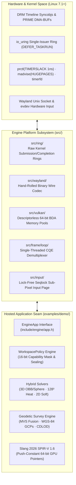
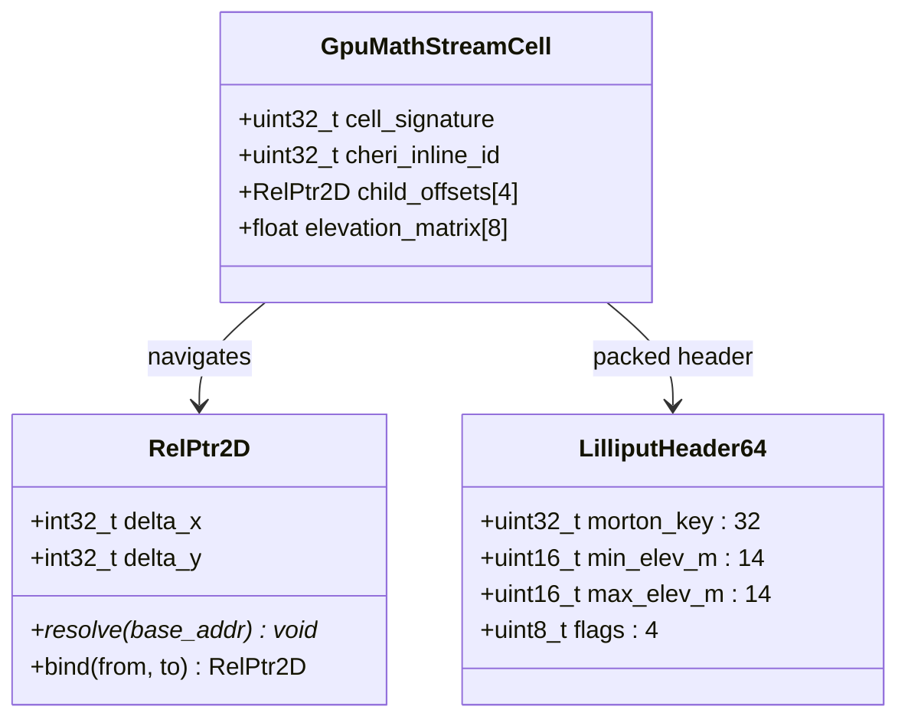
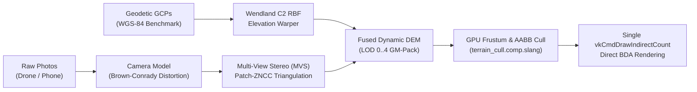
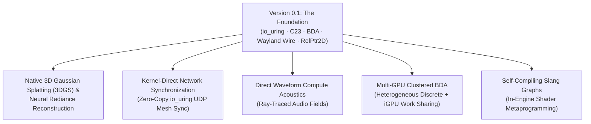

# Modular C23 Engine (v0.1 Alpha)

> *"To truly understand a machine, you must refuse to inherit the compromises of the past thirty years. We did not build another wrapper; we reinvented the wheel from the silicon up."*

---

### Key Architectural Pillars
- **Strict ISO C23 (`-std=c23`)** · Zero external runtime dependencies · Zero wrapper middleware.
- **Bare-Metal Linux 7.1+ Kernel Runtime** · Direct `io_uring` event loop · Zero-overhead idle sleep.
- **Hand-Crafted Wayland Wire Protocol** · Custom binary codec · Zero `libwayland`.
- **Pure Linux DRM Timeline Explicit Sync** · PRIME `DMA-BUF` surfaces · Zero `VkSwapchainKHR` (WSI-free).
- **Vulkan 1.4 Descriptorless BDA** · 64-bit Buffer Device Addresses · Zero `VkDescriptorSet` / descriptor pools.
- **Slang 2026 Shading Language** · Target SPIR-V 1.6 · Direct GPU pointer arithmetic.
- **Relocatable Spatial Pointer Algebra** · 64-bit 2D Self-Relative Pointers (`RelPtr2D`) · Lilliput 64-bit compact headers.
- **Hybrid Multi-Modal Simulation** · 3D rigid bodies · 128³ heat compute lattice · 2D mass-spring soft bodies.
- **Geodetic & Photogrammetric Survey Fusion** · Real $24\times 24\,\text{km}$ DEM terrain streaming · Multi-View Stereo (MVS).
- **Capability-Masked Security Engine** · Granular `PolicyMask` · Cryptographic-style policy sealing.

---

## Table of Contents

1. [The Manifesto: Why We Reinvented the Wheel](#1-the-manifesto-why-we-reinvented-the-wheel)
2. [What This Engine Is Doing (Systems Architecture)](#2-what-this-engine-is-doing-systems-architecture)
   - [The Single Seam Principle](#the-single-seam-principle)
   - [The Bare-Metal `io_uring` Asynchronous Event Loop](#the-bare-metal-io_uring-asynchronous-event-loop)
   - [True Zero-Overhead Idle Sleep (0% CPU / 0% GPU)](#true-zero-overhead-idle-sleep-0-cpu--0-gpu)
   - [Descriptorless Vulkan 1.4 BDA Memory Subsystem](#descriptorless-vulkan-14-bda-memory-subsystem)
   - [WSI-Free Wayland Wire & DRM Timeline Explicit Sync](#wsi-free-wayland-wire--drm-timeline-explicit-sync)
3. [Groundbreaking Data Structures & Pointer Mathematics](#3-groundbreaking-data-structures--pointer-mathematics)
   - [2D Self-Relative Pointers (`RelPtr2D`)](#2d-self-relative-pointers-relptr2d)
   - [Lilliput 64-bit Compact Headers](#lilliput-64-bit-compact-headers)
   - [64-Byte Cache-Line Stateful Function Cells (`GpuMathStreamCell`)](#64-byte-cache-line-stateful-function-cells-gpumathstreamcell)
4. [What It Is Capable Of Doing (Features & Capabilities)](#4-what-it-is-capable-of-doing-features--capabilities)
   - [Multi-Modal Physics & Geometry Systems](#multi-modal-physics--geometry-systems)
   - [Photogrammetric & Geodetic Survey Fusion Engine](#photogrammetric--geodetic-survey-fusion-engine)
   - [Declarative Scene DSLs & Live Hot-Reloading](#declarative-scene-dsls--live-hot-reloading)
   - [Capability Masking & Workspace Policies](#capability-masking--workspace-policies)
   - [Runtime World Hot-Switching (`F1`..`F10` / `0`)](#runtime-world-hot-switching-f1f10--0)
   - [Programmatic C23 `WorldBuilder` API](#programmatic-c23-worldbuilder-api)
5. [The Horizon: Version 0.1 is Just the Beginning](#5-the-horizon-version-01-is-just-the-beginning)
6. [Quick Start & Build Instructions](#6-quick-start--build-instructions)
7. [World Tour Reference (`--world=0..9`)](#7-world-tour-reference---world09)
8. [Interactive Controls Reference](#8-interactive-controls-reference)
9. [Repository Architecture Directory](#9-repository-architecture-directory)

---

## 1. The Manifesto: Why We Reinvented the Wheel

### The Crisis of Modern Engine Bloat
For over three decades, game and simulation engines have accumulated layers of legacy compromises:
- **Abstraction Upon Abstraction**: Modern software stacks hide simple hardware truths behind millions of lines of legacy middleware. Windowing wrappers (SDL, GLFW) drag along legacy X11 abstractions. Window System Integrations (Vulkan WSI `VkSwapchainKHR`) introduce unpredictable presentation queues, thread stalls, and hidden compositor round-trips.
- **Resource Exhaustion by Default**: Booting an "empty" scene in popular commercial engines spins multiple worker threads, consumes hundreds of megabytes of resident memory, burns GPU watts polling for events that never occur, and allocates thousands of descriptor sets through complex dynamic pools.
- **Pervasive Leaky Abstractions**: Developers are taught to treat the operating system as an enemy to be abstracted away, rather than a precision instrument to be harnessed directly.

### The Zero-Middleware Philosophy
We asked a fundamental question:
> **What does a high-performance simulation and graphics engine look like if we start completely from scratch in 2026, targeting only pure modern Linux kernel primitives and modern Vulkan hardware?**

To answer this, we strictly banned every ubiquitous third-party helper library:
- **No `libwayland-client`**: We wrote our own binary wire codec directly over Linux Unix sockets.
- **No `liburing`**: We construct, map, submit, and reap kernel rings via raw `syscall(__NR_io_uring_register, ...)`.
- **No SDL / GLFW**: We parse raw evdev scancodes, manage xkb state tables, and maintain cursor protocols directly.
- **No `VkSwapchainKHR`**: We allocate raw Linux `DMA-BUF` graphics surfaces in Vulkan device-local memory and present them via `wp_linux_drm_syncobj_v1` DRM timeline synchronization primitives.
- **No `<stdbool.h>` or Legacy C Idioms**: Built with pure, modern ISO C23 (`-std=c23`) using true language booleans (`bool`, `true`, `false`), `nullptr`, `<stdbit.h>`, compound literals, and strict type safety.

The result is **`engine-v2`**: a radical, single-process, deterministic software system that runs at the bare metal with zero hidden costs, microsecond wakeups, and mathematical elegance.

---

## 2. What This Engine Is Doing (Systems Architecture)



### The Single Seam Principle
The engine is bifurcated across **one strict, immutable boundary** defined in [`include/engine/app.h`](include/engine/app.h):
1. **The Platform Engine (`src/`, `include/`)**: Owns kernel introspection, CPU topology probes, ring memory allocations, raw Wayland wire IPC, DMA-BUF surfaces, Vulkan 1.4 logical devices, BDA memory slabs, and the frame clock. **It contains zero knowledge of 3D geometry, meshes, physics, terrain, or keybindings.**
2. **The Hosted Program (`examples/demo/`)**: Implements the `const EngineApp *engine_app(void)` interface. It owns the scene graphs, cameras, capability masks, physics solvers, photogrammetric pipelines, and rendering passes.

### The Bare-Metal `io_uring` Asynchronous Event Loop
Instead of spawning thread pools that fight for CPU cache coherence and trigger kernel context switches, the engine runs on a **single execution thread** governed by Linux `io_uring` ([`src/frame/loop/run.c`](src/frame/loop/run.c)):
- Configured with `IORING_SETUP_SINGLE_ISSUER | IORING_SETUP_DEFER_TASKRUN | IORING_SETUP_NO_MMAP | IORING_SETUP_REGISTERED_FD_ONLY`.
- Maps application-managed anonymous memory slabs for SQ, CQ, provided buffer rings (`PBUF`), and timer buffer rings (`SIM`).
- Registers fixed file descriptors and sets `prctl(PR_SET_TIMERSLACK, 1UL)` so kernel wakeups occur within **1 nanosecond** of expiration instead of the standard $50\,\mu\text{s}$ operating system default.
- Multiplexes the Wayland wire socket, signals (`signalfd`), simulation ticks (`timerfd`), filesystem changes (`inotify`), and asynchronous disk reads (`ring_read_file_all`) without a single polling spinlock.

### True Zero-Overhead Idle Sleep (0% CPU / 0% GPU)
In standard software, an open window continually polls or renders idle frames. In `engine-v2`:
- Physics and motions run on a dedicated $8\,\text{ms}$ interval `timerfd` ($\Delta t = 125\,\text{Hz}$).
- When all 3D bodies settle, soft meshes stop deforming, and the camera halts, `frame_sim_wanted()` returns `false`.
- The engine disarms the simulation `timerfd`, logs `Loop idle`, and drops into `io_uring_enter2(ENTER_GETEVENTS | NO_IOWAIT)`.
- **The process consumes 0.0% CPU and 0.0% GPU cycles.** It sleeps peacefully in kernel wait queues until the user moves the pointer or hits a key.

### Descriptorless Vulkan 1.4 BDA Memory Subsystem
Traditional Vulkan code spends significant CPU time allocating descriptor sets, binding descriptor pools, and writing descriptor copies. 

This engine eliminates the entire concept of descriptors:
- **Zero `VkDescriptorSet`**: Shaders receive 64-bit Buffer Device Addresses (`uint64_t`) directly via `vkCmdPushConstants2`.
- **Slang 2026 Pointer Dereferencing**: Shaders cast these raw 64-bit pointers directly to struct pointers in GPU registers:
  ```slang
  // shaders/camera.slang
  MaterialTable *materials = (MaterialTable*)push_constants.materials_bda;
  float4 base_color = materials->entries[instance_id].albedo;
  ```
- **64 MiB Unified Device Slabs ([`src/vulkan/memory/bda.c`](src/vulkan/memory/bda.c))**: Memory is managed in 64 MiB device-local slabs backed by an intrusive, cache-aligned coalescing free-list (`BDA_STORAGE_ALIGN = 64`). ReBAR (`DEVICE_LOCAL | HOST_VISIBLE | HOST_COHERENT`) slabs are automatically leveraged so CPU ray-queries can read live GPU compute fields with zero staging stalls.

### WSI-Free Wayland Wire & DRM Timeline Explicit Sync
We do not use `VkSwapchainKHR`. Instead, we communicate directly with the compositor and the Linux Direct Rendering Manager (DRM):
1. **Wayland Wire Codec ([`src/wayland/wire/`](src/wayland/wire/))**: Reads and writes raw Wayland wire streams directly to socket memory using ring-backed `sendmsg`/`recvmsg` with `SCM_RIGHTS` file descriptor passing.
2. **Exportable PRIME DMA-BUFs**: Frame buffers are allocated on the Vulkan device with `VK_EXTERNAL_MEMORY_HANDLE_TYPE_DMA_BUF_BIT_EXT`, exported via `vkGetMemoryFdKHR`, and imported into Wayland via `zwp_linux_dmabuf_v1`.
3. **DRM Timeline Syncobjs**: Frame synchronization occurs entirely via explicit kernel timeline syncobjs (`wp_linux_drm_syncobj_manager_v1`). GPU execution signals an exported timeline `sync_file` descriptor, which is imported into the compositor via `DRM_IOCTL_SYNCOBJ_FD_TO_HANDLE`. The compositor and GPU synchronize directly in kernel space without CPU stalling.

---

## 3. Groundbreaking Data Structures & Pointer Mathematics



### 2D Self-Relative Pointers (`RelPtr2D`)
Standard pointers store 64-bit absolute virtual memory addresses. If you write an absolute pointer to disk or transfer it to the GPU, it breaks unless swizzled. 

[`include/backend/math/relptr2d.h`](include/backend/math/relptr2d.h) introduces **`RelPtr2D`**:
- A 64-bit integer packing two signed 32-bit offsets $(\Delta x, \Delta y)$ relative to the pointer's own position in memory:
  $$\text{target\_address} = \text{self\_address} + \Delta x + (\Delta y \times \text{stride})$$
- Enables complex quadtree spatial graphs and spatial scene hierarchies to be written straight from SSD into GPU VRAM or transferred across network sockets **with zero pointer patching, zero deserialization passes, and zero fixup tables**.

### Lilliput 64-bit Compact Headers
Inspired by high-density managed runtimes, [`include/backend/math/cell64.h`](include/backend/math/cell64.h) implements 64-bit unified node headers:
- **32-Bit Morton Z-Order Key**: Interleaves $(X, Y)$ spatial coordinates into a single 1D space-filling curve key for instant spatial hashing and bounding checks.
- **Quantized Elevation Bounds**: Compresses minimum elevation ($14\,\text{bits}$, $0.5\,\text{m}$ resolution) and maximum elevation ($14\,\text{bits}$) for instant camera frustum culling.
- **Status Flags**: Packed into the remaining 4 bits (residence, dirty state, LOD depth).

### 64-Byte Cache-Line Stateful Function Cells (`GpuMathStreamCell`)
Every stream cell in the terrain and compute pipeline is aligned to exactly **64 bytes—the exact width of an x86-64 and GPU L1 cache line**.
- Guaranteed zero false sharing across CPU cores and GPU wavefronts.
- Includes a CHERI-D inspired inline lifetime generation ID tag (`cheri_inline_id`) to mathematically prevent temporal use-after-free aliasing in recycled memory slabs.

---

## 4. What It Is Capable Of Doing (Features & Capabilities)

### Multi-Modal Physics & Geometry Systems
The engine seamlessly blends distinct physical domains within the same coordinate frame:
- **3D Rigid & Elastic Body Mechanics ([`examples/demo/world/motion.c`](examples/demo/world/motion.c))**: Volume-preserving squash-and-stretch deformation ($\text{scale}_z = \text{clamp}(1 + s, 0.45, 1.85)$), restitution sorting ($e = 0.08 .. 0.92$), and orientation integration across cubes, tetrahedrons, octahedrons, icosahedrons, cylinders, cones, and tori.
- **128³ FP16 Volumetric Lattice & Fillet Heat Engine ([`examples/demo/render/grid.c`](examples/demo/render/grid.c))**: Real-time 3D heat diffusion solver executed on GPU compute queues. Clicking an object injects thermal energy that propagates across geometric fillets and visually radiates through emission shaders.
- **2D Mass-Spring Soft Patches ([`examples/demo/world/sheet.c`](examples/demo/world/sheet.c))**: Dynamic spring-damper lattices with customizable stiffness ($k_s$), damping ($k_d$), and restitution that deform elastically against static obstacles.
- **SAT Convex Polygon Collisions**: High-speed Separating Axis Theorem solvers governing 2D bounce arenas.
- **Interactive Ear-Clipped Polygon Faces ([`examples/demo/world/face/clip.c`](examples/demo/world/face/clip.c))**: Clicking on the metric ground plane places real-time vertices. Hitting `F` or closing the loop automatically ear-clips the concave/convex vertices into rendered 3D planar polygons.

---

### Photogrammetric & Geodetic Survey Fusion Engine
Integrated in [`src/backend/terrain/survey/`](src/backend/terrain/survey/) and World 8 (`--world=besparmak`):



1. **$24\times 24\,\text{km}$ Real SRTM Terrain Streaming**:
   Streams real-world elevation ($788.6\,\text{m}$ to $1,638.0\,\text{m}$) and satellite imagery of Turkey's Beşparmak Dağı & Baklan plain from a $136\,\text{MiB}$ `.gmpack` archive lazily via batched `io_uring` read SQEs without stuttering.
2. **Drone & Smartphone Ingestion**:
   Directly ingests uncalibrated camera photos with preset sensors (iPhone 15 Pro, DJI Mavic 3 Enterprise, Sony RX100) or explicit focal lengths. Corrects lens distortion via radial ($k_1, k_2, k_3$) and tangential ($p_1, p_2$) Brown-Conrady coefficients.
3. **Multi-View Stereo (MVS) Dense Triangulation**:
   Sweeps depth rays across overlapping camera frustums, computing zero-mean normalized cross-correlation (Patch-ZNCC) to triangulate dense 3D surface elevations.
4. **Geodetic Ground Control Points (GCPs) & Fault Breaklines**:
   Incorporates high-precision WGS-84 surveyed benchmarks and fault lines, applying compactly-supported **Wendland $C^2$ Radial Basis Functions (RBF)** to adjust local terrain meshes smoothly.
5. **GPU-Driven Indirect Culling**:
   `terrain_cull.comp.slang` tests `RelPtr2D` quadtree leaf nodes against the camera frustum and Lilliput elevation bounds, atomically emitting indirect draw commands to drive presentation via a single `vkCmdDrawIndirectCount` call.

---

### Declarative Scene DSLs & Live Hot-Reloading
Scenes, 2D sheets, and photogrammetric surveys are defined in human-readable declarative text files that hot-reload in real-time via `inotify` and `io_uring`:

#### 1. The 3D Scene DSL (`.world`)
```text
ground z                     # Metric infinite ground plane at z=0
mode hybrid                  # Initial workspace: 3d, 2d, or hybrid
camera 0 -450 200 0 -0.32 1.0 0 # X Y Z yaw pitch zoom turntable
clear 0.02 0.04 0.08         # Deep obsidian clear color (RGB)

# Physical Primitives: Kind X Y Z yaw spin inf glow bounce
cube 0 -180 600 yaw 38000 spin 1 inf 0 glow 1 bounce 0.85
solid Icosahedron -460 150 640 yaw 18000 spin 1 inf 1 glow 1 bounce 0.90

# Procedural Composite Directives
ringcube 0 0 0 450 12 0.85 1 # Circular ring of 12 glowing cubes
tower 100 100 0 40 8 0.70    # Stacking column of 8 cubes
```

#### 2. The 2D Sheet Physics DSL (`sheet.world`)
```text
gravity 0 -680               # 2D gravity vector (gx, gy)
bounds 580 310               # Arena half-extents

# Rigid Bodies & Deformable Meshes
rigid 0 -240 450 20 15 0.90 1
soft -340 150 5 4 32 22 2.2 0.78
```

#### 3. The Photogrammetric Survey DSL (`besparmak_survey.manifest`)
```text
mvs_config 18.0 0.40 0.55     # MVS search range (m), step (m), and min ZNCC
photo "drone_ridge.png" preset="DJI Mavic 3 Enterprise" lat=37.9522 lon=29.6171 alt=1850 yaw=45 pitch=-60 roll=0 weight=0.95 mvs=1
point_wgs84 37.960556 29.636667 1690.8 120.0 0.98   # Summit benchmark with 120m RBF influence
breakline_wgs84 37.9522 29.6171 1307.0 37.9605 29.6366 1690.8 45.0 0.95 # Ridge spine
```

---

### Capability Masking & Workspace Policies
Security and modal interaction are enforced through fine-grained capability masks ([`examples/demo/include/frame/policy.h`](examples/demo/include/frame/policy.h)):

```c
enum : uint32_t {
    PERM_NONE         = 0u,
    PERM_CAM_PAN_X    = 1u << 0,  // Arrow keys, Middle-Drag
    PERM_CAM_ZOOM     = 1u << 2,  // Mouse Wheel, +/-
    PERM_CAM_YAW      = 1u << 3,  // Q/E, Right-Drag X
    PERM_CAM_PITCH    = 1u << 4,  // C/V, Right-Drag Y
    PERM_OBJ_SELECT   = 1u << 6,  // Left-Click picking
    PERM_OBJ_SPAWN    = 1u << 7,  // 1..6 solid creation
    PERM_MODE_SWITCH  = 1u << 14, // Tab key workspace cycling
    PERM_DRAW         = 1u << 15, // Ground click-to-draw polygon faces
};
```
- **Profiles**:
  - `policy_blender()` (`MODE_3D`): Full 6-DOF quaternion camera and 3D authoring permissions.
  - `policy_matplotlib()` (`MODE_2D`): Locks camera to front identity view; **strictly revokes yaw and pitch capabilities**.
  - `policy_hybrid()` (`MODE_HYBRID`): Simultaneous 3D and 2D authoring.
- **Policy Sealing**:
  Calling `policy_seal(p)` irreversibly locks the policy. Any subsequent calls to `policy_grant()`, `policy_revoke()`, or `policy_rebind_key()` are permanently rejected.

---

### Runtime World Hot-Switching (`F1`..`F10` / `0`)
Pressing `F1` through `F10` (or `0`) switches between 10 built-in world configurations in real time:
- **No Swapchain Recreation**: Reuses allocated Vulkan pipelines, memory slabs, and Wayland surfaces.
- **State Serialization**: Automatically flushes active changes to `live.world` before swapping.
- **Zero-Allocation Transition**: Flushes object tables and re-populates target scenes seamlessly.

---

### Programmatic C23 `WorldBuilder` API
Construct complex procedural environments purely in C23 code without touching DSL text files:

```c
#include "world/world_int.h"
#include "frame/policy.h"

int build_custom_amphitheater(void) {
    WorldBuilder wb;
    world_builder_begin(&wb, true /* smooth solids */);

    // 1. Configure workspace and camera
    world_builder_set_mode(&wb, MODE_HYBRID);
    world_builder_set_draw(&wb, true);
    world_builder_set_clear(&wb, 0.02f, 0.04f, 0.08f);
    world_builder_set_camera(&wb, 0.0f, -500.0f, 250.0f, 0.0f, -0.30f, 1.0f, false);

    // 2. Procedural Ring of Glowing Cubes
    Coord center = { 0.0f, 0.0f, 0.0f };
    world_builder_add_cube_ring(&wb, center, 400.0f /* radius */, 16 /* count */, 0.85f /* bounce */, true /* glow */);

    // 3. Commit directly into live scene tables
    return world_builder_commit(&wb);
}
```

---

## 5. The Horizon: Version 0.1 is Just the Beginning

> [!IMPORTANT]
> **Version 0.1 is not a finished game engine—it is a proven architectural foundation.**

By proving that an engine can operate with zero middleware, zero descriptor sets, raw kernel explicit sync, and zero idle overhead, `engine-v2` lays the groundwork for the next generation of real-time computing systems:



1. **Native 3D Gaussian Splatting (3DGS) & Neural Fields**:
   With descriptorless BDA memory and direct 64-bit GPU pointer addressing, radiance fields and Gaussian ellipsoids become first-class memory primitives rendered alongside geometric meshes without copy overhead.
2. **Zero-Copy Networked Distributed State**:
   Leveraging `io_uring`'s registered buffer rings and `RelPtr2D` self-relative addressing to transmit live simulation states across machines with zero serialization or allocation.
3. **GPU Compute-Driven Physical Acoustics**:
   Simulating wave-equation sound propagation across geometry and terrain directly on Vulkan compute queues.
4. **Clustered Multi-GPU BDA Rendering**:
   Expanding explicit sync and DMA-BUF export to partition rendering seamlessly across discrete GPUs and integrated accelerators on the same PCIe bus.

---

## 6. Quick Start & Build Instructions

### System Requirements
- **OS**: Linux Kernel `7.1+` (tested and developed on Linux `7.3`).
- **Compositor**: Native Wayland session (`$WAYLAND_DISPLAY` set).
- **Compiler**: Modern C23-compliant GCC (`gcc >= 14` with `-std=c23`).
- **Shader Compiler**: Slang 2026 (`slangc` targeting SPIR-V 1.6).
- **Libraries**: Vulkan 1.4 loader, `freetype2`, `harfbuzz`, `fontconfig`, `libpng`, `xkbcommon`.

### Compilation
```bash
# Clone the repository
git clone https://github.com/your-org/engine-v2.git
cd engine-v2

# 1. Build optimized debug binary (-O0 -g3)
make

# 2. Build high-performance release binary (-O3 -flto=auto -DNDEBUG)
make release

# 3. Build native CPU-tuned binary (-march=native)
make release NATIVE=1

# 4. Run the comprehensive unit test suite (All 9 suites)
make test
```

### Multi-GPU Selection
```bash
# Force a specific probed GPU index
ENGINE_GPU_INDEX=0 ./build/release/bin/engine --world=8

# Prefer a GPU vendor or name substring with automatic fallback
ENGINE_GPU=NVIDIA ./build/release/bin/engine --world=5
ENGINE_GPU=Intel  ./build/release/bin/engine --world=3
```

---

## 7. World Tour Reference (`--world=0..9`)

Launch any world directly from the command line:
```bash
./build/release/bin/engine --world=<id>
```

| World Flag | Name | Workspace | Key Highlights |
| :---: | :--- | :---: | :--- |
| `--world=0` | **Pure Empty Engine** *(Default)* | `MODE_3D` | Opens with literally nothing. Zero objects, no ground grid, no HUD, no gimbal, dark obsidian clear color. Policy is sealed. The ultimate blank slate. |
| `--world=1` | **3D Draw Studio** | `MODE_3D` | Click on the metric ground plane to place vertices and preview connecting lines. Press `F` or click the start point to ear-clip them into a rendered 3D surface. |
| `--world=2` | **3D Gravity & Elastic Solids** | `MODE_3D` | Elevated icosahedrons, tori, octahedrons, cones, cylinders, and cubes falling with volume-preserving squash-and-stretch elasticity. |
| `--world=3` | **2D Soft Bodies & Polygons** | `MODE_2D` | Mass-spring soft patches (jelly, medium, stiff) and convex polygons bouncing off static angled bumpers under 2D gravity. |
| `--world=4` | **2D Draw Workshop** | `MODE_2D` | Clean 2D canvas with interactive point-and-click polygon drawing alongside soft patches. |
| `--world=5` | **Hybrid 3D + 2D Sandbox** | `MODE_HYBRID` | Simultaneous 3D falling elastic solids and 2D deformable soft meshes in one unified viewport. |
| `--world=6` | **Restitution & Bumper Lab** | `MODE_3D` | Side-by-side drop test of 6 distinct geometric solids with restitution graded from $0.14$ to $0.92$. |
| `--world=7` | **Procedural C23 Cathedral** | `MODE_HYBRID` | Generated entirely via the programmatic C23 `WorldBuilder` API (`builder.c`) without external files. |
| `--world=8` | **Beşparmak Dağı & Survey Fusion** | `MODE_3D` | $24\times 24\,\text{km}$ real SRTM DEM + satellite imagery streaming from SSD via `io_uring`, photogrammetric camera models, and WGS-84 GCP fusion. |
| `--world=9` | **Full Interactive Sandbox** | `MODE_3D` | Full interactive showcase with math/CSV data plots, HarfBuzz/FreeType SDF text, and live object editing. |

---

## 8. Interactive Controls Reference

| Input | `3D` Mode | `2D` Mode | `Hybrid` Mode |
| :--- | :--- | :--- | :--- |
| **`F1` .. `F9` / `F10` (`0`)** | Hot-switch to Worlds `1..9` / Pure Empty Engine (`0`) | Same | Same |
| **Left Click (Ground)** | Place polygon vertex (when `PERM_DRAW` is active) | Place polygon vertex | Place polygon vertex |
| **Left Click (Object)** | Pick & shove 3D body; in World 8 sets Geodesic Survey | Pick & shove 2D body | Pick 2D body first, else 3D body |
| **First Point Click / `F`** | Ear-clip 3+ points into a solid planar face | Ear-clip into 2D face | Ear-clip points into face |
| **`Tab`** | Cycle `3D` $\to$ `2D` (if unmasked) | Cycle `2D` $\to$ `Hybrid` | Cycle `Hybrid` $\to$ `3D` |
| **`1` .. `6`** | Spawn Tetrahedron, Octahedron, Icosahedron, Cylinder, Cone, Torus | Disabled | Spawn 3D Solid `1..6` |
| **`S` / `G`** | Toggle smooth normals / Toggle material glow | Toggle face glow | Smooth solids / Toggle glow |
| **`R` / `F5`** | Toggle infinite spin / Impart rotational impulse | Toggle 2D spin | Toggle spin / Impart impulse |
| **`X` / `Delete` / `Backspace`** | Delete selected object or remove last drawn point | Delete selected 2D body | Delete selection or point |
| **`Z`** | Undo: Restore last deleted solid with its pose and restitution | Disabled | Restore last deleted 3D object |
| **Middle-Drag / Arrows** | Pan camera on screen axes | Pan 2D camera | Pan camera on screen axes |
| **Right-Drag / `Q`,`E` / `C`,`V`** | Orbit camera yaw and pitch | Locked (`lock_2d_quat`) | Orbit camera yaw and pitch |
| **Mouse Wheel / `+` / `-`** | Smooth metric zoom ($0.0001\times$ to $10000\times$) | Smooth zoom | Smooth zoom |
| **`Numpad 8, 2, 4, 6, 5, 1`** | Camera snaps: Top / Bottom / Left / Right / Front-Back / Home | Snap Front (`KP5`), Home (`KP1`) | Full Numpad camera snaps |
| **`Numpad 7` / `Numpad 9`** | Toggle orientation gimbal / Toggle `PERM_DRAW` | Toggle `PERM_DRAW` | Toggle gimbal / `PERM_DRAW` |
| **`K` / `Numpad 0`** | Toggle $20\,\text{m}$ / $100\,\text{m}$ topographic contour lines (World 8) | Toggle contours | Toggle contours |
| **`M` / `L`** | Cycle 3D math plot / Hot-reload active `.world` & `.manifest` | Cycle plot / Reload `sheet.world` | Cycle plot / Hot-reload all DSLs |
| **Hold `T` + 2 Clicks** | Place interactive SDF text box (Type text, `Esc` to commit) | Place SDF text box | Place SDF text box |

---

## 9. Repository Architecture Directory

```text
include/
├── backend/         GPU-Math, Terrain Streaming & Photogrammetric/Geodetic Survey headers
├── chrome/          Declarative window chrome box, layer, spec & GPU pass headers
├── engine/          app.h — the single seam between platform and hosted application
├── frame/           FrameClock, generation handles & frame loop state
├── input/           Lock-free seqlock input page & Wayland pointer/keyboard headers
├── ring/            Registered io_uring context, SQ/CQ/PBUF/SIM arenas & async chains
├── system/          Kernel & hardware capabilities (CPU topology, io_uring query, VMA)
├── util/            Zero-allocation FmtBuf integer/string formatting
├── vulkan/          Vulkan 1.4 context, device scoring, BDA slabs/arenas & pipeline bank
└── wayland/         Raw Wayland wire codec, DMA-BUF tranches & DRM syncobj timelines

src/
├── backend/
│   ├── core/        64-byte Stateful Function Cell dispatcher + CHERI-D inline_id
│   ├── math/        2D Self-Relative Pointers (RelPtr2D), Morton Z & Lilliput64
│   └── terrain/     .gmpack SSD reader/writer, CDLOD stream pager & MVS photogrammetry
├── chrome/          Window bar layout, SDF/vector chrome rendering & inotify spec parser
├── frame/           io_uring event loop, ordered boot, 8 ms timerfd sim & DRM explicit present
├── input/           Sub-pixel motion accumulator, xkb keymap, seat lifecycle & wire decoders
├── ring/            NO_MMAP arena allocation, VMA naming, registered FDs & linked async chains
├── system/          CPUID topology/ISA detector, chained IORING_REGISTER_QUERY & hugepages
├── vulkan/          Descriptorless BDA allocator, DMA-BUF export & Maintenance5 pipeline bank
└── wayland/         Ring-backed sendmsg/recvmsg wire framing & SCM_RIGHTS FD passing

shaders/             Slang 2026 shaders compiled to SPIR-V 1.6 (camera, material, lighting,
                     terrain_cull, terrain, cube, solid, shape, plane, plot, gimbal, mesh, hud)
examples/demo/       Hosted 3D/2D/Hybrid application, multi-path WorldBuilder, 10 world presets,
                     Baklan & Beşparmak Dağı SSD map archive, 3D/2D solvers & SDF text engine
tests/               Standalone unit test suites (handles, clock, world, motion, policy, sheet,
                     text, bda, backend)
```

---

<p align="center">
  <b>Modular C23 Engine · Built from the metal up.</b>
</p>
