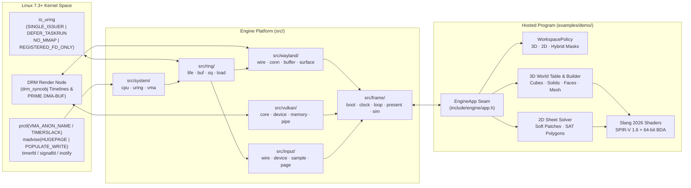
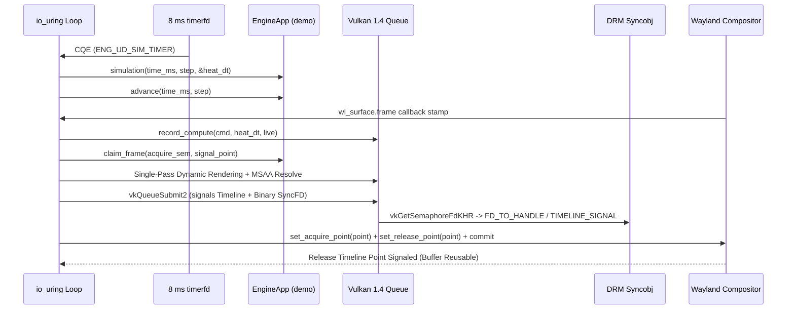

# Modular C23 Engine

> [!IMPORTANT]
> **Pure C23 · Zero Wrapper Libraries · Linux 7.1+ · Vulkan 1.4 Descriptorless BDA · Slang 2026 (SPIR-V 1.6)**
> A single-process, event-driven 3D/2D graphics and physics engine written in strict ISO C23 (`-std=c23`). It communicates with the Wayland compositor over a hand-rolled wire protocol on a registered `io_uring` socket, manages GPU memory through Vulkan 1.4 Buffer Device Address (`VK_KHR_buffer_device_address`) slabs without descriptor sets, and presents Linux `DMA-BUF` surfaces synchronized via `wp_linux_drm_syncobj_v1` DRM timeline syncobjs.

---

## Table of Contents

1. [Architectural Overview](#1-architectural-overview)
2. [Zero-Middleware Platform Stack](#2-zero-middleware-platform-stack)
3. [Explicit-Sync Frame & Simulation Lifecycle](#3-explicit-sync-frame--simulation-lifecycle)
4. [Selectable Worlds & Capability Masking (`--world=0..7`)](#4-selectable-worlds--capability-masking---world07)
5. [Multi-Path World Construction System](#5-multi-path-world-construction-system)
6. [Vulkan 1.4 BDA & Slang 2026 Shader Architecture](#6-vulkan-14-bda--slang-2026-shader-architecture)
7. [Interactive Controls & Workspace Profiles](#7-interactive-controls--workspace-profiles)
8. [Build, Verification & GPU Selection](#8-build-verification--gpu-selection)
9. [Repository Directory Hierarchy](#9-repository-directory-hierarchy)

---

## 1. Architectural Overview

The binary is divided along one strict seam defined in [`include/engine/app.h`](include/engine/app.h):

- **Platform Engine (`src/`, `include/`)**: Owns hardware and kernel introspection (`src/system/`), the `io_uring` submission/completion ring (`src/ring/`), the raw Wayland wire protocol and `DMA-BUF` / DRM syncobj presentation (`src/wayland/`), the lock-free seqlock input page (`src/input/`), the declarative window chrome (`src/chrome/`), the Vulkan 1.4 device and BDA memory subsystem (`src/vulkan/`), and the frame/simulation scheduler (`src/frame/`). It has zero knowledge of cubes, solids, plots, or key bindings.
- **Hosted Application (`examples/demo/`)**: Implements `const EngineApp *engine_app(void)` and provides the `3D`, `2D`, and `Hybrid` workspaces, capability-masked input routing (`policy.c`), 3D rigid/elastic OBB + spherical solid physics (`motion.c`), 128³ fp16 volume lattice & fillet heat compute (`grid.c`, `cube.c`), 2D mass-spring soft patches & SAT convex polygons (`sheet.c`), ear-clipped interactive faces (`face.c`), data plots (`plot.c`), and HarfBuzz/FreeType SDF text (`text/`).



---

## 2. Zero-Middleware Platform Stack

> [!NOTE]
> `libwayland`, `liburing`, SDL, GLFW, `VK_KHR_swapchain` (WSI), and `<stdbool.h>` are strictly banned across the entire repository. Every protocol packet, ring doorbell, and explicit synchronization primitive is authored directly in C23.

### Kernel & Hardware Introspection (`src/system/`)
- **CPU Topology & ISA Probe (`src/system/probe/cpu.c`)**: Executes raw `cpuid` leaves and `<stdbit.h>` bit operations (`stdc_count_ones_ui`, `stdc_bit_width_ui`) alongside `sched_getaffinity()` to report logical cores, cache line size, L1d/L2/L3 cache capacities, and hardware support for `AVX2`, `FMA`, `BMI2`, `F16C`, and `AVX-512F`.
- **Chained `io_uring` Kernel Query (`src/system/probe/uring.c`)**: Issues `syscall(__NR_io_uring_register, -1, IORING_REGISTER_QUERY, ...)` to inspect supported request/register opcodes and verify `IORING_FEAT_NO_IOWAIT`, `IORING_FEAT_RECVSEND_BUNDLE`, `IORING_FEAT_MIN_TIMEOUT`, `IORING_FEAT_CQE_SKIP`, `IORING_FEAT_EXT_ARG`, and `IORING_FEAT_REG_REG_RING`.
- **VMA Naming, Hugepages & Timer Slack (`src/system/memory/vma.c`)**:
  - Sets `prctl(PR_SET_TIMERSLACK, 1UL)` so the `io_uring` thread wakes with `1 ns` timer slack instead of the default `50 µs`.
  - Raises `RLIMIT_MEMLOCK` (targeting `64 MiB` for pinned `io_uring` buffers) and `RLIMIT_NOFILE`.
  - Tags anonymous `mmap` arenas via `prctl(PR_SET_VMA, PR_SET_VMA_ANON_NAME, ...)` so ring memory appears in `/proc/self/maps` and `/proc/self/smaps` as `[io_uring:sq_cq]`, `[io_uring:pbuf]`, and `[io_uring:sim]`, and pre-faults arenas with `madvise(..., MADV_HUGEPAGE)` and `MADV_POPULATE_WRITE`.

### Registered `io_uring` Engine (`src/ring/`)
- Initializes a single-issuer ring with `IORING_SETUP_SINGLE_ISSUER | IORING_SETUP_DEFER_TASKRUN | IORING_SETUP_NO_MMAP | IORING_SETUP_REGISTERED_FD_ONLY`, backed by application-allocated, page-aligned anonymous memory regions (`SQ=64`, `CQ=256`, `PBUF=32×8192 B` provided-buffer ring, `SIM=16×8 B` timer buffer ring, `3` fixed buffers, `16` registered file slots).
- Multiplexes the Wayland socket, `signalfd`, `timerfd` (8 ms simulation clock), `inotify` (live reload of `chrome/window.chrome`), and async file chains (`ring_read_file_all`) on a single thread without polling loops.

### WSI-Free Wayland Wire & Explicit Sync (`src/wayland/`, `src/frame/present/`)
- Speaks the Wayland wire protocol directly over the registered socket using `sendmsg`/`recvmsg` and `SCM_RIGHTS` FD passing.
- Queries `zwp_linux_dmabuf_feedback_v1` tranches for the surface's target DRM device (`major:minor`). When running on a muxless hybrid system where the discrete GPU differs from the display compositor's GPU, the engine renders into optimal device-local VRAM and issues a `vkCmdCopyImage2` (`prime_copy`) into a linear `DMA-BUF` exportable to the display GPU.
- Synchronizes every frame with `wp_linux_drm_syncobj_v1` timelines:
  - Uses a dual-semaphore signal (`VK_SEMAPHORE_TYPE_TIMELINE` for internal host/BDA retirement tracking + binary `VK_EXTERNAL_SEMAPHORE_HANDLE_TYPE_SYNC_FD_BIT` exported via `vkGetSemaphoreFdKHR`).
  - Handles the Vulkan specification allowance where `vkGetSemaphoreFdKHR` returns `fd == -1` when a `SYNC_FD` semaphore is already signaled by immediately signaling the timeline point via `DRM_IOCTL_SYNCOBJ_TIMELINE_SIGNAL`.
  - Imports valid `sync_file` descriptors into the DRM timeline via `DRM_IOCTL_SYNCOBJ_FD_TO_HANDLE` (`DRM_SYNCOBJ_FD_TO_HANDLE_FLAGS_TIMELINE`), with an automatic fallback to a temporary binary `drm_syncobj` + `DRM_IOCTL_SYNCOBJ_TRANSFER` on older kernels.

---

## 3. Explicit-Sync Frame & Simulation Lifecycle



- **Zero Idle GPU Traffic**: The `8 ms` simulation `timerfd` is armed only while physics, animations, compute fields, or held camera keys are active. Once bodies settle and spins finish, the timer disarms, the engine logs `Loop idle`, and the process sleeps in `io_uring_enter2` with zero CPU/GPU wakeups until the next input event.
- **Generation-Stamped Handles**: Both frame slots (`FrameHandle`) and world objects (`WorldObj`) embed a generation counter (`(generation << 8) | (index + 1)`). Recycled slots or deleted objects increment their generation so stale handles never alias new allocations.

---

## 4. Selectable Worlds & Capability Masking (`--world=0..8`)

Launch any built-in world preset from the command line using `--world=<0..8>`, `--world <name>`, or `-w <0..8>`:

```bash
./build/release/bin/engine --help
./build/release/bin/engine --world=1     # 3D-Only Click-to-Draw Studio
./build/release/bin/engine --world=2     # 3D-Only Gravity & Elastic Non-Cube Solids
./build/release/bin/engine --world=3     # 2D-Only Gravity, Soft Bodies & Elastic Polygons
./build/release/bin/engine --world=4     # 2D-Only Click-to-Draw Polygon Workshop
./build/release/bin/engine --world=5     # Hybrid 3D+2D Click-to-Draw, Gravity & Soft Bodies
./build/release/bin/engine --world=6     # 3D+2D Switchable Restitution Staircase & Bumper Lab
./build/release/bin/engine --world=7     # Procedural C23 Builder: Kinetic Cathedral & Cascade
./build/release/bin/engine --world=8     # Baklan & Beşparmak Dağı Real DEM + Satellite Map (--world=besparmak)
```

| World Flag | Alias | Workspace Mode | `PERM_MODE_SWITCH` (`Tab`) | `PERM_DRAW` (Boot) | Physics, Geometry & Scene Highlights |
| :--- | :--- | :--- | :---: | :---: | :--- |
| `--world=0` | `default` | `MODE_3D` | Open (`3D`/`2D`/`Hybrid`) | Off (`KP9` toggles) | Default sandbox ([`opening.world`](examples/demo/world/opening.world) / `live.world` + [`sheet.world`](examples/demo/world/sheet.world)). |
| `--world=1` | `draw3d` | **3D-Only** (`MODE_3D`) | **Locked** (Revoked) | **ON** | **3D Click-to-Draw Studio** ([`world1.world`](examples/demo/world/world1.world)): Ground clicks immediately place points and connecting lines; clicking the first corner again ($\ge 3$ pts) or pressing `F` ear-clips them into a 3D face. Framed by glowing non-cube solids. |
| `--world=2` | `gravity3d` | **3D-Only** (`MODE_3D`) | **Locked** (Revoked) | Off (`KP9` toggles) | **3D Gravity & Elastic Non-Cube Solids** ([`world2.world`](examples/demo/world/world2.world)): Elevated `Icosahedron`, `Torus`, `Octahedron`, `Cone`, `Tetrahedron`, `Cylinder`, and cubes drop under gravity with distinct restitution (`0.08..0.90`) and volume-preserving squash-and-stretch deformation. |
| `--world=3` | `soft2d` | **2D-Only** (`MODE_2D`) | **Locked** (Revoked) | Off (`KP9` toggles) | **2D Gravity, Soft Bodies & Elastic Polygons** ([`sheet3.world`](examples/demo/world/sheet3.world)): Downward 2D gravity (`0, -680`) and arena bounds with 3 mass-spring soft patches (`spring=22` jelly, `58` medium, `145` stiff) and convex polygons (`bounce=0.28..0.92`) rebounding off angled fixed bumpers. |
| `--world=4` | `draw2d` | **2D-Only** (`MODE_2D`) | **Locked** (Revoked) | **ON** | **2D Click-to-Draw Polygon Workshop** ([`sheet4.world`](examples/demo/world/sheet4.world)): Open 2D central canvas where clicks place points $\to$ lines $\to$ faces (`F` or click start point), surrounded by soft patches and elastic polygons. |
| `--world=5` | `hybrid` | **Hybrid** (`MODE_HYBRID`) | Open (`Tab` cycles) | **ON** | **Combined 3D + 2D Sandbox** ([`world5.world`](examples/demo/world/world5.world) + [`sheet5.world`](examples/demo/world/sheet5.world)): Simultaneous 3D falling elastic solids/cubes, 2D deformable soft bodies, and active click-to-draw points/lines/faces. |
| `--world=6` | `bounce` | **3D + 2D** (`MODE_3D`) | Open (`Tab` cycles) | Off (`KP9` toggles) | **Restitution Staircase & Bumper Lab** ([`world6.world`](examples/demo/world/world6.world) + [`sheet6.world`](examples/demo/world/sheet6.world)): Side-by-side lineup of all 6 non-cube solids and 3 cubes dropped from $z = 520$ with graded bounce (`0.14..0.92`), paired with a 2D walled bumper arena. |
| `--world=7` | `procedural` | **Hybrid** (`MODE_HYBRID`) | Open (`Tab` cycles) | **ON** | **Procedural C23 `WorldBuilder` Cathedral**: Generated entirely in C23 code (`builder.c`) without external `.world` files—an amphitheater ring of cubes, a helical spiral of falling elastic solids, and a procedurally synthesized 2D harmonic polygon/soft-body chamber. |
| `--world=8` | `besparmak` / `baklan` / `map` | **Pure 3D Map** (`MODE_3D`) | **Locked** (Pure Map) | Off (Ray-Pick Survey) | **Baklan & Beşparmak Dağı $31\times 31\text{ km}$ Dynamic SSD-Streamed DEM & True-Color Satellite Map**: Pure, clutter-free 3D terrain world (`4800 × 4800` world units, zero extra objects/plots) with real measured SRTM elevation (`700.0 m .. 1,690.8 m`) and $128\times 128$-per-tile Esri World Imagery (`examples/demo/maps/baklan_besparmak.gmpack`, `7.98 MiB`) streamed dynamically from SSD as you zoom via 2D Self-Relative Pointers (`RelPtr2D`), Lilliput 64-bit tile headers, and 64-byte Stateful Function Cells. See [`TERRAIN_BACKEND_ARCHITECTURE.md`](TERRAIN_BACKEND_ARCHITECTURE.md). |

---

## 5. Multi-Path World Construction System

Worlds in `examples/demo/` can be constructed and combined through **three distinct paths**:

### Path A: Declarative `.world` & `sheet.world` Scene Files (`load.c`, `sheet.c`)
 Both single-primitive records and higher-level composite generators are supported in `.world` and `sheet.world` files:

```text
# 3D Scene Directives (examples/demo/world/*.world)
ground z
smooth 1
cube 0 -180 600 yaw 38000 spin 1 inf 0 glow 1 bounce 0.85
solid Icosahedron -460 150 640 yaw 18000 spin 1 inf 1 glow 1 bounce 0.90
ringcube 0 0 0 560 6 0.72 1
tower 0 0 180 260 3 0.65
arcsolid 0 160 380 55 480 0.25 0.92

# 2D Sheet Directives (examples/demo/world/sheet*.world)
gravity 0 -680
bounds 580 310
rigid -330 -120 110 18 -16 0.75 1
soft -340 150 5 4 32 22 1.0 0.78
polyring -180 250 42 6 0.92
```

### Path B: Programmatic C23 `WorldBuilder` & `WorldBlueprint` API (`builder.c`)
Complex parametric worlds can be assembled directly in C23 using `WorldBuilder` and `WorldBlueprint` descriptors in [`examples/demo/world/builder.c`](examples/demo/world/builder.c):
- `world_builder_begin(&wb)` / `world_builder_commit(&wb)`
- `world_builder_add_cube_ring(&wb, center, radius, count, restitution, glow)`
- `world_builder_add_solid_helix(&wb, center, radius, z_start, z_step, b0, b1)`
- `world_builder_add_cube_tower(&wb, base, z_step, levels, restitution)`
- `world_builder_populate_sheet_arena(gravity_x, gravity_y, bound_x, bound_y)`

### Path C: Live Interactive Authoring (`face.c`, `world.c`)
- Granting `PERM_DRAW` (enabled at boot in Worlds `1`, `4`, `5`, `7`, or toggled anytime with `Numpad 9`) lets clicks on `z = 0` place vertices, preview edges in real time, and triangulate arbitrary non-self-intersecting polygons via ear-clipping (`clip.c`) when pressing `F` or clicking the starting vertex.

---

## 6. Vulkan 1.4 BDA & Slang 2026 Shader Architecture

> [!TIP]
> There are **zero `VkDescriptorSet` or `VkDescriptorPool` objects** in the engine. Every shader stage reads vertex buffers, material tables, soft-body state, and 3D volume lattices directly via 64-bit GPU pointers (`uint64_t` Buffer Device Addresses) passed in `vkCmdPushConstants2`.

- **BDA Memory Hierarchy (`src/vulkan/memory/bda.c`)**:
  - **Device Pool**: `64 MiB` `VK_MEMORY_PROPERTY_DEVICE_LOCAL_BIT` slabs with coalescing free-list suballocation (`BDA_STORAGE_ALIGN`). Automatically maps ReBAR (`DEVICE_LOCAL | HOST_VISIBLE | HOST_COHERENT`) slabs so CPU clicks can read GPU heat fields in place.
  - **Staging Pool**: Host-visible, coherent, cached slabs for zero-stall dynamic geometry uploads (`12` ring-buffered slices per subsystem, reclaimed via `vkGetSemaphoreCounterValue` without calling `vkQueueWaitIdle`).
  - **Transient Ring**: `16 MiB` dual-half per-frame bump allocator indexed by `(signal_point & 1)`.
- **Shared Slang 2026 Modules (`shaders/`)**:
  - [`shaders/camera.slang`](shaders/camera.slang): Quaternion view transform (`view_rotate`, `view_of`, `view_ndc`) and vertex structs (`MeshVertex`, `SoftVertexState`).
  - [`shaders/material.slang`](shaders/material.slang): Cache-line-aligned 32-byte BDA material table lookup (`MaterialTable*`).
  - [`shaders/lighting.slang`](shaders/lighting.slang): Shared physically-inspired direct sun + hemisphere sky/ground irradiance + GGX microfacet specular + Fresnel rim + emissive shading used across `cube.frag.slang`, `solid.frag.slang`, and `mesh.frag.slang`.
  - [`shaders/solid.vert.slang`](shaders/solid.vert.slang): Volume-preserving squash-and-stretch deformation ($\text{scale}_z = \text{clamp}(1 + s, 0.45, 1.85)$, $\text{scale}_{xy} = 1/\sqrt{\text{scale}_z}$) with inverse-transpose normal rescaling.
  - [`shaders/plane.frag.slang`](shaders/plane.frag.slang): Infinite multi-decade metric grid using SPIR-V 1.6 subgroup `WaveRotate` (`spvGroupNonUniformRotateKHR`) and wrapped camera phase (`plane_grid_phase`) to prevent `float32` jitter at extreme pan/zoom (`0.0001` to `10000`).

---

## 7. Interactive Controls & Workspace Profiles

| Key / Input | `3D` Profile (`MODE_3D`) | `2D` Profile (`MODE_2D`) | `Hybrid` Profile (`MODE_HYBRID`) |
| :--- | :--- | :--- | :--- |
| **Left Click (Empty)** | Place face vertex (if `PERM_DRAW` on) | Place face vertex (if `PERM_DRAW` on) | Place face vertex (if `PERM_DRAW` on) |
| **Left Click (Object)** | Select object; shove/bounce cube or solid & plant heat | Select & shove 2D rigid/soft/polygon body (or 2D face) | Shove 2D sheet body first, else pick/shove 3D object |
| **First Vertex Click / `F`** | Close 3+ points into ear-clipped face | Close 3+ points into ear-clipped face (`PERM_DRAW`) | Close 3+ points into ear-clipped face |
| **`Tab`** | Switch `3D` $\to$ `2D` (unless `PERM_MODE_SWITCH` locked) | Switch `2D` $\to$ `Hybrid` (unless locked) | Switch `Hybrid` $\to$ `3D` |
| **`1` .. `6`** | Raise/select Tetrahedron, Octahedron, Icosahedron, Cylinder, Cone, Torus | Disabled | Raise/select 3D solid `1..6` |
| **`S` / `G` / `R` / `F5`** | Smooth solids / Toggle glow / Toggle infinite spin / Respin | Toggle spin/glow on 2D faces (`PERM_DRAW`) | Smooth / Glow / Spin / Respin |
| **`X` / `Del` / `Bksp`** | Delete selected object, pop open corner, or delete fallback cube | Delete selected 2D sheet body or face/corner | Delete 2D sheet selection or 3D object |
| **`Z`** | Restore last removed cube, solid, or mesh (with its restitution & pose) | Disabled | Restore last removed 3D object |
| **Arrows / Middle-Drag** | Pan camera on screen axes | Pan 2D sheet camera | Pan camera on screen axes |
| **`Q`,`E` / `C`,`V` / Right-Drag** | Orbit camera yaw & pitch | Locked (`lock_2d_quat = true`) | Orbit camera yaw & pitch |
| **Wheel / `+` / `-`** | Zoom in/out (`0.0001` .. `10000`) | Zoom in/out | Zoom in/out |
| **`Numpad 8,2,4,6,5,1,7,9`** | Top/Bottom/Left/Right/Front-Back/Home/Gimbal/Toggle `PERM_DRAW` | Home (`KP1`), Snap Front (`KP5`), Toggle `PERM_DRAW` (`KP9`) | Full Numpad camera & `PERM_DRAW` controls |
| **`M` / `L`** | Cycle math plot / Async reload CSV + OBJ | Cycle math plot / Reload CSV + `sheet.world` | Cycle math plot / Reload CSV + OBJ + `sheet.world` |
| **Hold `T` + 2 Clicks** | Place interactive HarfBuzz/FreeType SDF text box | Place interactive SDF text box | Place interactive SDF text box |

---

## 8. Build, Verification & GPU Selection

### Prerequisites
- **OS**: Linux kernel `7.1+` (tested on `7.3`), active Wayland session.
- **Toolchain**: `gcc` with `-std=c23`, `slangc` (Slang 2026 / SPIR-V 1.6), Vulkan 1.4 headers (`VK_API_VERSION_1_4`), `freetype2`, `harfbuzz`, `fontconfig`, `xkbcommon`.

```bash
# Build debug binary (-O0 -g3)
make

# Build portable release binary (-O3 -flto=auto -DNDEBUG)
make release

# Build native CPU-tuned release binary (-march=native)
make release NATIVE=1

# Run unit & subsystem test suite
make test
```

### Multi-GPU Selection
```bash
# Force a specific probed physical device index
ENGINE_GPU_INDEX=0 ./build/release/bin/engine --world=2

# Prefer a vendor, device type, or name substring (with automatic fallback)
ENGINE_GPU=NVIDIA ./build/release/bin/engine --world=6
ENGINE_GPU=Intel  ./build/release/bin/engine --world=3
```

---

## 9. Repository Directory Hierarchy

```text
include/
├── backend/         GPU-Math & Terrain Streaming headers (RelPtr2D, Cell64, .gmpack, stream)
├── chrome/          Declarative window chrome box, layer, spec & GPU pass headers
├── engine/          app.h — the single seam between platform and hosted program
├── frame/           64-byte aligned FrameClock, generation handles & frame loop state
├── input/           Lock-free seqlock input page & Wayland pointer/keyboard headers
├── ring/            Registered io_uring context, SQ/CQ/PBUF/SIM arenas & async chains
├── system/          Kernel & hardware capabilities (CPU topology, io_uring query, VMA)
├── util/            Zero-allocation FmtBuf integer/string formatting
├── vulkan/          Vulkan 1.4 context, device scoring, BDA slabs/arenas & pipeline bank
└── wayland/         Raw Wayland wire codec, DMA-BUF tranches & DRM syncobj timelines

src/
├── backend/
│   ├── core/
│   │   ├── cell/    64-byte Stateful Function Cell dispatcher + CHERI-D inline_id
│   │   └── context/ GPU-Math BDA arena lifecycle, ray-terrain picker & zoom coordinator
│   ├── math/
│   │   ├── gpu/     256-byte PULSE Active GPU Window & Slang 2026 compute filter pass
│   │   └── pointer/ 2D Self-Relative Block Pointers (RelPtr2D), Morton Z & Lilliput64
│   └── terrain/
│       ├── storage/ Baklan & Beşparmak Dağı .gmpack SSD reader/writer & synthesizer
│       └── stream/  Zoom-driven CDLOD quadtree selector & SSD -> GPU BDA tile pager
├── chrome/          Window bar layout, SDF/vector chrome rendering & inotify spec parser
├── frame/
│   ├── boot/        Ordered bring-up, GPU fallback loop & reverse LIFO teardown
│   ├── clock/       Fixed-point refresh tracker & GPU timestamp queries
│   ├── loop/        Single-issuer io_uring event loop, CQE absorber & file reload relay
│   ├── present/     Explicit-sync DMA-BUF slots, prime_copy, barriers & orphan retirement
│   └── sim/         8 ms timerfd fixed-step accumulator
├── input/
│   ├── device/      Cursor shape protocol, xkb keymap & seat lifecycle
│   ├── page/        GPU compute input page & seqlock publisher
│   ├── sample/      Keyboard hold/tap router & pointer motion accumulator
│   └── wire/        Wayland wl_seat / wl_pointer / wl_keyboard wire decoders
├── ring/
│   ├── buf/         Fixed buffers & provided-buffer ring (PBUF / SIM) management
│   ├── life/        NO_MMAP arena allocation, VMA naming, FD registration & teardown
│   ├── load/        Linked openat->statx->read->close async file chains
│   └── sq/          io_uring_enter2 with EXT_ARG, multishot timeouts & SQE encoders
├── system/
│   ├── memory/      RLIMIT_MEMLOCK/NOFILE, prctl(VMA_ANON_NAME/TIMERSLACK) & madvise
│   ├── probe/       x86-64 CPUID topology/ISA detector & chained IORING_REGISTER_QUERY
│   └── system.c     System bring-up orchestrator & capability reporter
├── vulkan/
│   ├── core/        Instance creation, validation probe, VkResult formatting & lifecycle
│   ├── device/      Physical device evaluator, queue family solver & DRM node matcher
│   ├── memory/      DMA-BUF exportable images, prime_copy & descriptorless BDA allocator
│   └── pipe/        Maintenance5 module-free pipeline bank & UUID-verified disk cache
└── wayland/
    ├── buffer/      zwp_linux_dmabuf_v1 feedback tranches & wp_linux_drm_syncobj_v1
    ├── conn/        Socket connection & registry global binding
    ├── surface/     xdg_toplevel, titlebar subsurface, opaque/input regions & commits
    └── wire/        Ring-backed sendmsg/recvmsg wire framing & SCM_RIGHTS FD passing

shaders/             Slang 2026 shaders compiled to SPIR-V 1.6 (camera, material, lighting,
                     terrain_math, terrain_filter, terrain, cube, solid, shape, plane, plot,
                     gimbal, mesh, hud, chrome, grid, heat)
examples/demo/       Hosted 3D/2D/Hybrid application, multi-path WorldBuilder, 9 world presets,
                     Baklan & Beşparmak Dağı SSD map archive, 3D/2D solvers & SDF text engine
tests/               Standalone unit tests (handles, clock, world, motion, policy, sheet, text,
                     bda, backend)
```
