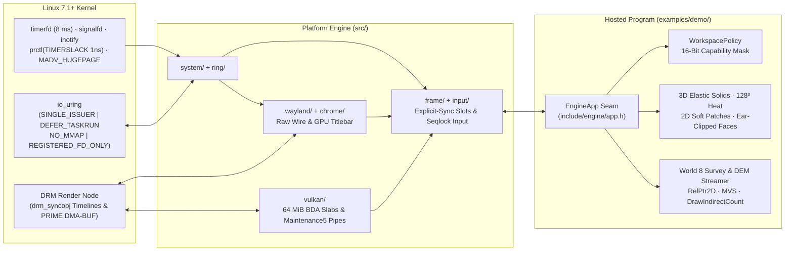

# Engine (`v0.2.0`)

**Pure ISO C23 (`-std=c23`) · Linux 7.1+ `io_uring` · Raw Wayland Wire · DRM Timeline Explicit Sync · Vulkan 1.4 Descriptorless BDA · Slang 2026 (SPIR-V 1.6)**

`Engine` is a 3D, 2D, and geospatial simulation/graphics engine written from scratch in strict ISO C23 (~62,000 lines of C23 and Slang, compiling into a single `2.91 MiB` release binary with all 37 SPIR-V 1.6 shaders and fonts embedded directly inside the executable via C23 `#embed`).

It uses **no windowing libraries** (`SDL`, `GLFW`), **no protocol wrappers** (`libwayland-client`), **no ring wrappers** (`liburing`), **no Vulkan WSI swapchain** (`VK_KHR_swapchain`), and **no Vulkan descriptor sets** (`VkDescriptorSet`). Instead, a single thread talks straight to the Linux kernel over a registered `io_uring` instance, speaks the Wayland binary wire protocol over a Unix socket, presents exported `DMA-BUF` images synchronized with Linux DRM `drm_syncobj` timelines, and addresses all GPU buffers through raw 64-bit GPU pointers (`VK_KHR_buffer_device_address`).

---

## Documentation Map

This README gives a clear, human-readable tour of why the engine exists, what it does, how it compares to conventional engines, and how to build and run it. For code-level deep dives, read the companion engineering documents:

| Document | What It Covers |
| :--- | :--- |
| **[`doc/PLATFORM_AND_RENDER_INTERNALS.md`](doc/PLATFORM_AND_RENDER_INTERNALS.md)** | Low-level code walkthrough of `src/`: `io_uring` arena flags & side-CQE relays, raw Wayland wire framing, WSI-free `DMA-BUF` + DRM syncobj swapchain, cache-line layouts, Vulkan 1.4 BDA slab allocator, `#embed`ded Slang 2026 pipelines, and the linker dead-code gate. |
| **[`doc/WORKFLOW_CONTROLS_AND_EXTENSIBILITY.md`](doc/WORKFLOW_CONTROLS_AND_EXTENSIBILITY.md)** | How `EngineApp` (`include/engine/app.h`) works, keyboard/mouse routing, capability masking (`PolicyMask` & sealing), `F1`–`F10` live world switching, `.world` / `sheet.world` / `.manifest` / `window.chrome` DSL grammars, the C23 `WorldBuilder` API, and copy-paste customization recipes. |
| **[`TERRAIN_BACKEND_ARCHITECTURE.md`](TERRAIN_BACKEND_ARCHITECTURE.md)** | World 8's $24\times 24\text{ km}$ Baklan & Beşparmak Dağı `.gmpack` streaming backend, `RelPtr2D` 2D self-relative pointers, Lilliput 64-bit tile headers, 64-byte stateful cells, GPU `vkCmdDrawIndirectCount` culling, Brown-Conrady lens calibration, Multi-View Stereo (MVS), and WGS84 geodetic fusion. |
| **[`doc/ARCHITECTURE_COMPARISON.md`](doc/ARCHITECTURE_COMPARISON.md)** | Concrete, layer-by-layer architectural comparison of `Engine` against Unreal/Unity/Godot, `SDL3`/`GLFW` + `VkSwapchainKHR` stacks, and `GDAL` + `Cesium` + offline photogrammetry pipelines—including honest trade-offs. |
| **[`doc/V02_GPU_PROFILES_AND_2026_ALGORITHMS.md`](doc/V02_GPU_PROFILES_AND_2026_ALGORITHMS.md)** | `Engine v0.2` Dual-Architecture specification (`UMA_IGPU`, `DISCRETE_DIRECT`, `HYBRID_MUXLESS`) and 2026 algorithms roadmap (`.epack` v1 codec, async `io_uring`, quantized meshlets, `SSILVB`, Split Radiance Cascades, `AVBD`, `2DGS`). |
| **[`doc/BENCHMARK_V01_VS_V02_M1.md`](doc/BENCHMARK_V01_VS_V02_M1.md)** | Hardware benchmark report comparing `v0.1` Baseline vs `v0.2` Milestone 1 (`UMA_IGPU` zero-staging BDA pool, `HOST_CACHED` LLC ranking, adaptive `2x MSAA`, `-69.7%` UMA RAM reduction). |
| **[`doc/BENCHMARK_V02_M2.md`](doc/BENCHMARK_V02_M2.md)** | Three-way empirical report (`v0.1` vs `v0.2-M1` vs `v0.2-M2`): `0.00 ms` non-blocking `io_uring` tile streaming, `3.84x` `.epack` v1 GPU-decoded terrain codec (`4.01x` total World 8 RAM reduction), and `HYBRID_MUXLESS` partial-damage PRIME presentation. |
| **[`doc/BENCHMARK_V02_M3.md`](doc/BENCHMARK_V02_M3.md)** | Four-way empirical report (`v0.1` vs `M1` vs `M2` vs `v0.2-M3`): unified `16 B/vert` quantized meshlet scene kernel (`5.35x` geometry compression), Subgroup single-pass `Hi-Z` + Two-Phase GPU occlusion culling, `1x R32_UINT` Visibility Buffer + analytical barycentric specular AA, and **`2.03x`–`2.32x` faster** 3D frame times. |
| **[`doc/BENCHMARK_V02_M4.md`](doc/BENCHMARK_V02_M4.md)** | Five-way empirical report (`v0.1` vs `M1` vs `M2` vs `M3` vs `v0.2-M4`): descriptorless `src/lighting/` Global Illumination subsystem — 32-bit `SSILVB` visibility bitmasks (`countbits` AO, bent normals & local bounce), 4-level Lambert equal-area Split Radiance Cascades (`HRC`), dual hardware oracles (`UMA_IGPU` vs `DISCRETE_DIRECT`), and `VisBuf + GI` synergy inside a single `40 MiB` UMA BDA slab. |
| **[`doc/BENCHMARK_V02_M5.md`](doc/BENCHMARK_V02_M5.md)** | Final `Engine v0.2` six-way empirical report (`v0.1` -> `v0.2-M5`): first-class `src/physics/` 2026 Augmented Vertex Block Descent (`AVBD`, $3 \times 3$ $L D L^\top$ + fused SLM graph-colored compute) and World 8 Slang compute plane-sweep `ZNCC` MVS + 32-byte Oriented `2DGS` geodetic surfels inside a single `40 MiB` UMA BDA slab. |
| **[`pointers.md`](pointers.md)** | Research background behind the 2025–2026 pointer architectures implemented in `src/backend/` (`RelPtr2D`, Project Lilliput compact headers, 64-byte flat closures, CHERI-D inline lifetime IDs, and PULSE active windows). |
| **[`doc/engineers_note.md`](doc/engineers_note.md)** | Build segregation (`build/debug` vs. `build/release`), semantic version tagging, and Vulkan/DRM runtime contracts. |

---

## Table of Contents

1. [Why We Rebuilt the Wheel from Scratch](#1-why-we-rebuilt-the-wheel-from-scratch)
2. [How `Engine` Compares to Other Engines & Stacks](#2-how-engine-compares-to-other-engines--stacks)
3. [How the Engine Works (Plain-English Architecture)](#3-how-the-engine-works-plain-english-architecture)
4. [What `v0.2.0` Is Capable Of Today](#4-what-v020-is-capable-of-today)
5. [Where `Engine` Goes Beyond `v0.2.0`](#5-where-engine-goes-beyond-v020)
6. [Quick Start: Build, Test, Run & GPU Selection](#6-quick-start-build-test-run--gpu-selection)
7. [Selectable Worlds (`--world=0..9` & Live `F1`–`F10` Switching)](#7-selectable-worlds---world09--live-f1f10-switching)
8. [Interactive Controls Reference](#8-interactive-controls-reference)
9. [Repository Directory Layout](#9-repository-directory-layout)

---

## 1. Why We Rebuilt the Wheel from Scratch

In almost every modern graphics project or game engine on Linux, putting a single interactive scene on screen passes through five or six layers of general-purpose middleware:

```text
Your Code -> Engine Scene Graph -> SDL3 / GLFW -> libwayland-client (locks + heap proxies)
          -> epoll / worker threads -> Vulkan WSI (VkSwapchainKHR + vkWaitForFences)
          -> VkDescriptorPool / VkDescriptorSet -> GPU Driver
```

Each layer was written at a different time to hide old operating system quirks. Together, they create problems that are almost impossible to fix from the top:
- **Idle CPU & GPU burn**: Even when nothing on screen has moved for ten minutes, standard game loops keep waking `60`–`240` times per second, polling sockets and re-submitting identical frames.
- **Hidden presentation & resize stalls**: `VkSwapchainKHR` hides buffer ownership inside the driver. Dragging a window edge routinely triggers `VK_ERROR_OUT_OF_DATE_KHR` and `vkDeviceWaitIdle()` hitches, while `vkWaitForFences` blocks the CPU thread waiting on previous frames.
- **Descriptor bureaucracy**: Managing `VkDescriptorSetLayout`, pool sizes, and `vkUpdateDescriptorSets` burns CPU time when modern GPUs already have real 64-bit virtual memory pointers.
- **Pointer serialization walls**: Standard 64-bit `void*` host pointers break the moment data touches an SSD or a GPU buffer, forcing engines to parse disk formats into temporary CPU heap allocations and copy reorganized structs to VRAM.

With `Engine`, we made a deliberate engineering choice: **do not wrap legacy layers—build the foundation directly on Linux 7.1+ and Vulkan 1.4 first.**

Version `0.1.0` is that foundation. Instead of rushing to ship high-level game editors on top of leaky middleware, we built the hardest system layers cleanly from zero—so every higher-level tool added in `v0.2` and beyond inherits `0.0%` idle overhead, zero-copy SSD-to-GPU pointers, instant live world switching, and total control over every frame.

---

## 2. How `Engine` Compares to Other Engines & Stacks

For the full subsystem-by-subsystem breakdown (syscalls, cache lines, timelines, and honest trade-offs), see **[`doc/ARCHITECTURE_COMPARISON.md`](doc/ARCHITECTURE_COMPARISON.md)**. Here is the summary in plain numbers and mechanics:

| Area | Typical Engine (`UE5` / `Unity` / `Godot`) | Custom Native (`SDL3`/`GLFW` + Vulkan WSI) | **`Engine` (`v0.2.0`)** |
| :--- | :--- | :--- | :--- |
| **Compiled Footprint** | `80 MiB` – `500+ MiB` + external shader/pak folders | `5 MiB` – `30 MiB` + wrapper `.so`s + external `.spv`s | **`2.91 MiB` single release ELF** (all 37 SPIR-V 1.6 shaders & font `#embed`ded) |
| **Idle Resource Usage** | Continuous tick loop (`60–240 Hz` CPU/GPU wakeups) | Poll loop or coarse event wait | **`0.0%` CPU & `0.0%` GPU**. Disarms `timerfd`, logs `Loop idle`, sleeps in kernel |
| **OS I/O & Timers** | Thread pools + `epoll`/`poll` + mutexes/`futex` | `poll()` on socket + blocking file `read()` | **Single-issuer `io_uring`** (`NO_MMAP`, `DEFER_TASKRUN`, `REGISTERED_FD_ONLY`, `1 ns` timer slack) |
| **Windowing & Swapchain** | Wrapper $\to$ `libwayland` + `VkSwapchainKHR` | `libwayland` + `VkSwapchainKHR` + `vkWaitForFences` | **Hand-rolled Wayland wire + exported `DMA-BUF` + `wp_linux_drm_syncobj_v1` timelines** (zero fence waits) |
| **Window Titlebar** | XWayland / `libdecor` (`wl_shm` CPU software copy) | Compositor SSD or `libdecor` `wl_shm` | **GPU fragment shader into its own `DMA-BUF` on a desynced `wl_subsurface`** |
| **GPU Resource Binding** | Descriptor pools / global bindless descriptor heaps | `VkDescriptorSet` + `vkUpdateDescriptorSets` | **Zero `VkDescriptorSet`s**. Raw 64-bit `VkDeviceAddress` pointers in push constants |
| **Spatial Data Pointers** | Host `void*` + deserialization & pointer fixup passes | Separate disk, CPU, and GPU data structures | **`RelPtr2D` (64b 2D self-relative block pointers)** + Lilliput 64b headers; identical bytes on SSD, CPU & GPU |
| **Terrain + Survey Pipeline** | Separate offline tools (`COLMAP` + `GDAL` + `Cesium`) | Custom heightmap loader (static) | **Single binary**: `io_uring` `.gmpack` streaming + live `inotify` Brown-Conrady MVS & WGS84 RBF fusion |
| **Dead Code Policy** | Millions of lines of unexercised engine branches | Unused helpers silently kept or stripped | **Hard linker gate**: build fails (`[Link Error]`) if *any* function in `src/` is unused |

---

## 3. How the Engine Works (Plain-English Architecture)

### One Strict Seam Between Platform and Program (`include/engine/app.h`)
The codebase is split cleanly in two across a single C struct (`EngineApp` in [`include/engine/app.h`](include/engine/app.h)):
- **Platform Engine (`main.c`, `src/`, `include/`)**: Knows how to probe CPU caches and `io_uring` opcodes, manage ring buffers, speak Wayland, allocate `DMA-BUF` surfaces and 64 MiB Vulkan BDA slabs, track refresh pacing, and harvest hardware GPU timestamps. **It does not know what a cube, a terrain tile, a plot, or a keybinding is.**
- **Hosted Application (`examples/demo/`)**: Implements `const EngineApp *engine_app(void)` and supplies the 10 selectable worlds, 3D/2D/Hybrid physics solvers, capability-masked input policies, `.world`/`.manifest` parsers, and Slang draw passes. You can replace `examples/demo/` with an entirely different application without touching `src/`.



### Single-Threaded `io_uring` Loop & True `0%` Idle Sleep
Instead of juggling render threads, RHI threads, and file-loader threads with mutexes:
1. Everything runs on **one thread** inside [`src/frame/loop/run.c`](src/frame/loop/run.c).
2. Persistent file descriptors (Wayland socket, compositor release `eventfd`, `signalfd`, `inotify`, and the `8 ms` simulation `timerfd`) sit in registered kernel slots (`0..5`), serviced by multishot provided-buffer rings (`PBUF` and `SIM`).
3. **Physics never step on `vsync`**: The Wayland `wl_surface.frame` callback only measures monitor refresh rate (`period_q8` EMA) and paces rendering. Physics integrate strictly on fixed `8 ms` (`125 Hz`) ticks from `timerfd`, capped at `5` steps per wake so hitches never cause physics explosions.
4. **Idle means genuinely asleep**: The moment spinning/falling bodies come to rest, heat diffusion finishes, and camera keys are released, `frame_sim_wanted()` returns `false`. The engine disarms `timerfd`, prints `Loop idle`, and sleeps in `io_uring_enter2` using **`0.0%` CPU and `0.0%` GPU** until you move the mouse, press a key, or save a watched file.

### WSI-Free Swapchain & DRM Timeline Sync (`src/wayland/`, `src/frame/present/`)
When presenting a frame:
1. The GPU renders into an exported `DMA-BUF` image (`slot[0]` or `slot[1]`) inside a single dynamic rendering pass (with single-pass MSAA resolve when active) and records 4 hardware `vkCmdWriteTimestamp2` queries to measure exact GPU compute and render microseconds.
2. `vkQueueSubmit2` signals a Vulkan timeline semaphore (for host BDA memory retirement) alongside an exported `SYNC_FD` semaphore imported straight into the Wayland acquire `drm_syncobj` timeline (`DRM_IOCTL_SYNCOBJ_FD_TO_HANDLE`).
3. The CPU sends `wp_linux_drm_syncobj_surface_v1.set_acquire_point`, `set_release_point`, and `wl_surface.commit` over the raw Wayland socket—**never calling `vkWaitForFences`**. When the compositor finishes displaying the buffer, it signals the release timeline, waking `io_uring` via an `eventfd`.
4. On muxless hybrid laptops (e.g., discrete NVIDIA GPU rendering onto an integrated AMD/Intel Wayland compositor), the engine automatically renders in fast device-local VRAM and issues `vkCmdCopyImage2` (`prime_copy`) into a cross-GPU linear `DMA-BUF`.

### Descriptorless 64-Bit GPU Pointers & Next-Gen Spatial Addressing
- **Vulkan 1.4 BDA (`src/vulkan/memory/bda.c`)**: `BdaSystem` manages `64 MiB` device-local slabs with a coalescing free-list (auto-mapped over ReBAR when supported), coherent staging slices, and a `16 MiB` dual-half per-frame transient bump ring. Slang 2026 shaders receive `uint64_t` GPU addresses in push constants and dereference typed structs directly.
- **`RelPtr2D`, Lilliput 64-bit Headers & 64-Byte Cells (`src/backend/`)**:
  - **`RelPtr2D`** ([`include/backend/math/relptr2d.h`](include/backend/math/relptr2d.h)) packs a signed 20-bit `4 KB` block offset ($\pm 2\text{ GiB}$), inline 16-bit `(dX, dY)` grid coordinates, `LOD`, and an 8-bit `epoch ^ 0xA5` integrity tag into 64 bits. A single shift-add (`self + (delta << 12)`) resolves the same pointer on SSD, in CPU RAM, and inside GPU shaders—zero pointer swizzling when streaming tiles from disk to VRAM.
  - **`GpuMathTileHeader`** packs block offset, 16-bit Morton Z-order curve key, LOD, residency flags, and quantized min/max elevation (`0..2047 m`) into a single **8-byte** Lilliput-style header.
  - **`GpuMathStreamCell`** (`alignas(64)`) packs the completion function pointer, `RelPtr2D`, BDA destination, SSD offset, and CHERI-D `epoch`/`inline_id` lifetime bytes into **one exact 64-byte L1 cache line**.

---

## 4. What `v0.2.0` Is Capable Of Today

- **Pure Empty Boot by Default (`World 0`)**: Running `./build/release/bin/engine` with no flags boots a completely blank, zero-permission sealed engine—zero objects, no grid, no HUD, and `0.00 MiB` lazy GI/physics/terrain allocation—proving that the platform engine carries zero scene baggage unless asked.
- **Hardware-Adaptive Dual-Architecture Profiles (`UMA_IGPU` · `DISCRETE_DIRECT` · `HYBRID_MUXLESS`)**: Automatically detects True UMA `HOST_CACHED` LLC heaps (fitting all scenes inside a single zero-staging `40 MiB` BDA slab on 2020+ iGPUs), dedicated GDDR6/7 VRAM + ReBAR (`DISCRETE_DIRECT`), and cross-GPU muxless laptop topologies (`HYBRID_MUXLESS` with partial-damage `prime_copy` and async DMA transfer handoff).
- **Unified `16 B/vert` Meshlet Kernel, Subgroup Two-Phase `Hi-Z` & `R32_UINT` Visibility Buffer (`src/scene/`)**: Clusterizes procedural solid cages and `.obj` meshes into `64`-vertex / `124`-triangle meshlets (`uint16` local AABB positions + octahedral `snorm16` normals — **`5.35x` smaller** than raw `36 B` vertices), runs GPU normal-cone + frustum + Subgroup Two-Phase `Hi-Z` occlusion culling into `vkCmdDrawIndirectCount`, and supports live `Y`-key switching between hardware MSAA indirect rasterization and a `1x R32_UINT` Visibility Buffer deferred resolve with analytical screen-space barycentric derivatives and geometric specular AA (`0` `VkDescriptorSet`s).
- **2026 `SSILVB` 32-Bit Visibility Bitmasks & 4-Level Split Radiance Cascades GI (`src/lighting/`)**: First-class descriptorless Global Illumination kernel running 1-cycle `countbits` 32-bit angular sector bitmasks (`VBAO` ambient visibility, Jimenez multi-bounce AO, Lagarde specular occlusion, bent normals, and thickness-aware local bounce) fused with 4-cascade Lambert equal-area Split/Holographic Radiance Cascades (`HRC`) across dual hardware profiles (`102,400` analytical/DEM rays at half-res on `UMA_IGPU`; `412,160` rays at `3/4`-res on `DISCRETE_DIRECT`, live `H`-key toggle, `0.00 MiB` lazy cost on `World 0`).
- **2026 Augmented Vertex Block Descent (`AVBD`) Unified GPU/CPU Physics (`src/physics/`)**: First-class coupled rigid/soft-body solver (Giles, Diaz & Yuksel, SIGGRAPH 2025/2026) using a 18-FMA square-root-free $3 \times 3$ $L D L^\top$ register solver (immune to `fp32` cofactor overflow up to $k = 10^{18}$), Rockafellar-Wets unilateral contacts, SPD-stabilized 3D springs, greedy CSR graph coloring, and fused single-dispatch `groupshared` SLM compute (`physics_avbd.comp.slang`, `4` iterations on `UMA_IGPU` vs `8` on `DISCRETE_DIRECT`, live `8`-key toggle) alongside 128³ fp16 GPU thermal diffusion and SAT convex polygons.
- **Interactive Click-to-Draw Ear-Clipped Faces (`face.c`, `clip.c`)**: Granting `PERM_DRAW` lets ground clicks place vertices and preview edges; clicking the first corner or pressing `F` ear-clips arbitrary non-self-intersecting polygons into live 3D/2D faces.
- **$24\times 24\text{ km}$ Non-Blocking `.epack` DEM Terrain + GPU Compute MVS & Oriented `2DGS` Surfels (`World 8`)**:
  - Streams a 5-level (`LOD 0..4`, `341` tiles, `100 KiB`/tile `.epack` v1 GPU-decoded `8x8` planar + 5-bit DEM + lossless `u16` seam ring + BC1 satellite albedo, `33.32 MiB` SSD / `9.40 MiB` UMA window) archive of **Baklan & Beşparmak Dağı (Denizli, Türkiye)** asynchronously via `io_uring` (`0.00 ms` render-thread stall), with air-gapped C23 self-synthesis if absent.
  - Live-fuses smartphone/drone photos (12 built-in sensor presets, Brown-Conrady calibration), **Slang 2026 GPU Compute Plane-Sweep `ZNCC` MVS** (`survey_mvs.comp.slang`), and RTK-GNSS WGS84 control points/breaklines (`Wendland C2 RBF`), while rendering steep limestone cliffs and survey beacons as **32-byte Oriented 2D Gaussian Splatting (`2DGS`) Geodetic Surfels** (`WavePrefixCountBits` subgroup culling, Mip-2DGS anti-aliasing, Early-Z preserved, live `7`-key toggle).
- **Capability-Masked Input & Three World Authoring Paths**:
  - Every camera, object, plot, draw, and mode-switch operation passes through a 16-bit `PolicyMask` (`WorkspacePolicy`) that can be granted, revoked, rebound, or permanently **sealed** per world.
  - Author worlds via declarative `.world` / `sheet.world` files (live-reloaded via `inotify`), programmatic C23 `WorldBuilder` calls (`World 7`), or interactive in-window editing (auto-saved to `live.world`), complete with 3D math/CSV plots and HarfBuzz/FreeType SDF text boxes.

---

## 5. Where `Engine` Goes Beyond `v0.2.0`

With all five `v0.2` milestones complete, `Engine` unites Wayland explicit sync, hardware-adaptive `UMA_IGPU` / `DISCRETE_DIRECT` / `HYBRID_MUXLESS` execution, quantized meshlets + `VisBuf`, 2026 `SSILVB` + Split `HRC` GI, GPU `AVBD` physics, and `.epack` + `2DGS` photogrammetry inside a `2.91 MiB` binary (`1` single `40 MiB` UMA BDA slab, `0%` idle cost).

Future `v0.3+` directions build directly on these core subsystems:
1. **General glTF / Streaming Asset Archive on `RelPtr2D`**: Extending zero-swizzle `RelPtr2D` block pointers from `.epack` terrain to hierarchical meshlet DAGs, BCn PBR material atlases, and skeletal rigs paged straight from NVMe into BDA slabs via `io_uring`.
2. **Hardware `TLAS`/`BLAS` `RayQueryKHR` Acceleration & Spatial-Hash Broadphase**: Feeding `src/scene/` quantized meshlets into hardware ray-tracing acceleration structures on RT-capable dGPUs and scaling `src/physics/` `AVBD` to tens of thousands of GPU broadphase contacts.
3. **Zero-Copy `io_uring` Networking & PipeWire / Compute Audio**: Using the same single-issuer `io_uring` ring for deterministic UDP state synchronization and low-latency audio buffer submission without background threads.
4. **In-Engine Authoring & Geodetic Engineering Workbench**: Expanding `chrome/` + SDF text + `WorkspacePolicy` into a live capability-gated scene inspector and photogrammetric survey workbench.

---

## 6. Quick Start: Build, Test, Run & GPU Selection

### System Prerequisites
- **OS & Session**: Linux kernel `7.1+` (developed and tested on `7.3`) inside an active Wayland session (`$WAYLAND_DISPLAY` with `zwp_linux_dmabuf_v1` and `wp_linux_drm_syncobj_v1`).
- **Toolchain**: `gcc` (`>= 14`, supporting `-std=c23` and `#embed`), `slangc` (Slang 2026 targeting SPIR-V 1.6), Vulkan 1.4 loader & headers (`VK_API_VERSION_1_4`), `freetype2`, `harfbuzz`, `fontconfig`, `xkbcommon`, and `libpng`.

### Build & Verify
```bash
# 1. Build debug binary (-O0 -g3 -> build/debug/bin/engine)
make

# 2. Build LTO release binary (-O3 -flto=auto -DNDEBUG -> build/release/bin/engine)
make release

# 3. Build CPU-tuned native release binary (-march=native)
make release NATIVE=1

# 4. Run all 12 standalone unit & subsystem test suites
#    (handles, clock, world, motion, policy, sheet, text, bda, backend, scene, lighting, physics)
make test
```

### Run & Select GPUs
```bash
# Default boot: Pure Empty Engine (World 0 — blank obsidian viewport, sealed policy)
./build/release/bin/engine

# List all 10 built-in world presets (0..9)
./build/release/bin/engine --list-worlds

# Launch directly into a specific world or custom .world file
./build/release/bin/engine --world=8               # Baklan & Beşparmak Dağı DEM + Survey Map
./build/release/bin/engine --world=5               # Hybrid 3D + 2D Soft-Body & Draw Sandbox
./build/release/bin/engine --world=my_scene.world  # Custom declarative .world file

# Force a GPU by device index or vendor/name substring (automatic fallback if unavailable)
ENGINE_GPU_INDEX=0 ./build/release/bin/engine --world=2
ENGINE_GPU=NVIDIA  ./build/release/bin/engine --world=8
ENGINE_GPU=Intel   ./build/release/bin/engine --world=3

# Override execution profile, MSAA, VisBuf, Hi-Z, 2026 GI, AVBD physics, or 2DGS survey policy
ENGINE_GPU_PROFILE=auto|uma|discrete|hybrid ./build/release/bin/engine --world=8
ENGINE_MSAA=1 ENGINE_VISBUF=1 ENGINE_HIZ=auto ENGINE_GI=auto|1|0 ./build/release/bin/engine --world=7
ENGINE_PHYSICS=auto|gpu|cpu ./build/release/bin/engine --world=2
ENGINE_2DGS=auto|1|0 ENGINE_SURVEY_MANIFEST=examples/demo/maps/besparmak_survey.manifest ./build/release/bin/engine --world=8
```

### Ingest Drone / Smartphone Survey Photos into World 8
```bash
./scripts/ingest_survey_photo.py --list-presets
./scripts/ingest_survey_photo.py \
    --image my_drone_shot.png \
    --phone "DJI Mavic 3 Enterprise" --focal-mm 12.29 \
    --lat 37.90582 --lon 29.68415 --alt 1980 \
    --yaw 35 --pitch -60 --roll 0
```
If World 8 is open when `besparmak_survey.manifest` updates, `io_uring` `inotify` automatically re-fuses the affected DEM tiles in place without resetting your camera.

---

## 7. Selectable Worlds (`--world=0..9` & Live `F1`–`F10` Switching)

Press **`F1`–`F9`** at any time inside the running window to switch straight into Worlds `1..9`, or press **`F10` / `0`** to return to the Pure Empty Engine (`World 0`)—all in place, without restarting the process or recreating the Vulkan device.

| World Flag | Alias | Mode | `Tab` Switch | `PERM_DRAW` | What It Demonstrates |
| :--- | :--- | :--- | :---: | :---: | :--- |
| `--world=0` | `pure` / `empty` | `MODE_3D` | **Sealed** | Off | **Pure Empty Engine (Default)**: Zero 3D/2D objects, no ground grid, no gimbal, no HUD, no plots, sealed `PERM_NONE` policy. |
| `--world=1` | `draw3d` | `MODE_3D` | Locked | **ON** | **3D Click-to-Draw Studio**: Ground clicks place vertices and edges; clicking the first corner or pressing `F` ear-clips them into a 3D face. |
| `--world=2` | `gravity3d` | `MODE_3D` | Locked | Off (`KP9`) | **3D Gravity & Elastic Solids**: `Icosahedron`, `Torus`, `Octahedron`, `Cone`, `Tetrahedron`, `Cylinder`, and cubes falling with graded bounce (`0.08..0.90`) and squash-and-stretch deformation. |
| `--world=3` | `soft2d` | `MODE_2D` | Locked | Off (`KP9`) | **2D Soft Bodies & Polygons**: 3 mass-spring soft patches (`spring=22, 58, 145`) and SAT convex polygons rebounding off angled fixed bumpers. |
| `--world=4` | `draw2d` | `MODE_2D` | Locked | **ON** | **2D Polygon Workshop**: Open 2D drawing canvas surrounded by live soft-body patches and elastic polygons. |
| `--world=5` | `hybrid` | `MODE_HYBRID` | Open | **ON** | **Hybrid 3D + 2D Sandbox**: Simultaneous 3D falling elastic solids, 2D deformable soft patches, and active click-to-draw faces. |
| `--world=6` | `bounce` | `MODE_3D` | Open | Off (`KP9`) | **Restitution Staircase & Bumper Lab**: Side-by-side drop lineup of all 6 solids and 3 cubes (`bounce=0.14..0.92`) paired with a 2D bumper arena. |
| `--world=7` | `procedural` | `MODE_HYBRID` | Open | **ON** | **Procedural C23 Cathedral**: Built purely in C23 via `WorldBuilder` (`builder.c`) with zero external `.world` files—cube amphitheater, helical solid spiral, and harmonic 2D chamber. |
| `--world=8` | `besparmak` / `map` | `MODE_3D` | Locked | Survey 2-Pt | **Baklan & Beşparmak Dağı $24\times 24\text{ km}$ DEM & Survey Fusion**: 341-tile `io_uring` SSD-streamed SRTM DEM + Esri satellite map, GPU indirect frustum culling, contours, and live MVS/GCP photogrammetric fusion. |
| `--world=9` | `sandbox` | `MODE_3D` | Open | Off (`KP9`) | **Full Interactive Sandbox**: Persistent scene editing (`live.world`), 2D `sheet.world`, 3D math/CSV plots, and HarfBuzz/FreeType SDF text boxes. |

---

## 8. Interactive Controls Reference

| Input | `3D` Profile (`MODE_3D`) | `2D` Profile (`MODE_2D`) | `Hybrid` Profile (`MODE_HYBRID`) |
| :--- | :--- | :--- | :--- |
| **`F1` .. `F9` / `F10`, `0`** | Switch live to World `1..9` / `World 0` | Switch live to World `1..9` / `World 0` | Switch live to World `1..9` / `World 0` |
| **Left Click (Empty)** | Place polygon vertex (when `PERM_DRAW` on) | Place polygon vertex (`PERM_DRAW`) | Place polygon vertex (`PERM_DRAW`) |
| **Left Click (Object / Map)** | Pick/shove 3D object + 5s heat; in World 8 sets A$\to$B geodesic survey | Pick & shove 2D rigid/soft/polygon body | Shove 2D body first, else pick/shove 3D object |
| **First Vertex Click / `F`** | Ear-clip $\ge 3$ points into 3D face | Ear-clip $\ge 3$ points into 2D face | Ear-clip $\ge 3$ points into face |
| **`Tab`** | Switch `3D` $\to$ `2D` (if `PERM_MODE_SWITCH` set) | Switch `2D` $\to$ `Hybrid` | Switch `Hybrid` $\to$ `3D` |
| **`1` .. `6`** | Spawn/select Tetrahedron, Octahedron, Icosahedron, Cylinder, Cone, Torus | Disabled | Spawn/select 3D solid `1..6` |
| **`S` / `G` / `R` / `F5`** | Smooth normals / Toggle glow / Infinite spin / Respin | Spin/glow on 2D faces (`PERM_DRAW`) | Smooth / Glow / Spin / Respin |
| **`X` / `Del` / `Bksp` / `Esc`** | Delete selected object or open corner / Cancel | Delete 2D selection or corner / Cancel | Delete 2D or 3D selection / Cancel |
| **`Z`** | Restore last deleted cube, solid, or mesh | Disabled | Restore last deleted 3D object |
| **Arrows / Middle-Drag** | Pan camera on screen axes (1:1 ground pan in World 8) | Pan 2D sheet camera | Pan camera on screen axes |
| **`Q`,`E` / `C`,`V` / Right-Drag** | Orbit camera yaw & pitch (Z-up turntable in World 8) | Locked (`lock_2d_quat = true`) | Orbit camera yaw & pitch |
| **Wheel / `+` / `-`** | Zoom in/out (`0.0001x` .. `10,000x`, zoom-to-cursor in World 8) | Zoom in/out | Zoom in/out |
| **`Numpad 8,2,4,6,5,1,7,9`** | Top/Bottom/Left/Right/Front-Back/Home/Gimbal/Toggle `PERM_DRAW` | Home (`KP1`), Front (`KP5`), `PERM_DRAW` (`KP9`) | Full Numpad camera & `PERM_DRAW` controls |
| **`K` / `Numpad 0`** | Toggle `20 m` / `100 m` elevation contour lines (World 8) | Toggle contours | Toggle contours |
| **`Y`** | Toggle `1x R32_UINT` Visibility Buffer deferred shading vs MSAA Indirect | Toggle VisBuf policy | Toggle `1x R32_UINT` Visibility Buffer |
| **`H`** | Toggle 2026 `SSILVB` + Split Radiance Cascades Global Illumination | Toggle GI policy | Toggle 2026 `SSILVB` + Split `HRC` GI |
| **`7`** | Toggle Oriented `2DGS` Geodetic Surfels (World 8 cliffs & survey beacons) | Toggle `2DGS` policy | Toggle Oriented `2DGS` Surfels |
| **`8`** | Toggle GPU `AVBD` ($L D L^\top$ + Graph-Colored SLM) vs CPU `AVBD` physics | Toggle GPU/CPU `AVBD` on 2D soft patches | Toggle GPU/CPU `AVBD` physics |
| **`M` / `L`** | Cycle math/CSV plot / Hot-reload `.world`, CSV, OBJ & `.manifest` | Cycle plot / Hot-reload `.world`, CSV & `sheet.world` | Cycle plot / Hot-reload all active files |
| **Hold `T` + 2 Clicks** | Place interactive SDF text box (type UTF-8, `Esc` to finish) | Place interactive SDF text box | Place interactive SDF text box |

---

## 9. Repository Directory Layout

```text
main.c               Process entrypoint: CLI configure, signal block, ordered boot & reverse-LIFO shutdown
Makefile             Segregated debug/release build, Slang->SPIR-V 1.6 #embed rules, dead-code linker gate
chrome/              Declarative window.chrome specification for the GPU subsurface titlebar
doc/                 Deep-dive engineering guides (platform internals, workflow/controls, comparisons, notes)

include/
├── backend/         GPU-Math, RelPtr2D, 64B Stateful Cells, .gmpack & Photogrammetric Survey APIs
├── chrome/          Window bar layout, layer/control spec & GPU pass headers
├── engine/          app.h — the single seam between platform engine and hosted program
├── frame/           64B FrameClock, SlotRef generation handles & frame subsystem entrypoints
├── input/           Lock-free seqlock GPU input page & Wayland seat/pointer/keyboard headers
├── lighting/        2026 SSILVB 32-bit visibility bitmasks, 4-cascade Split HRC GI & BDA material look API
├── physics/         2026 AVBD 3x3 LDL^T unified rigid/soft solver, CSR graph coloring & GPU BDA compute API
├── ring/            Registered io_uring context, SQ/CQ/PBUF/SIM arenas & linked file chains
├── scene/           64v/124t quantized meshlets, octahedral snorm16, Subgroup Hi-Z & R32_UINT VisBuf API
├── system/          CPU topology/ISA probe, io_uring kernel feature query & VMA/hugepage tuning
├── util/            Zero-allocation FmtBuf integer/string formatting
├── vulkan/          Vulkan 1.4 context, device scorer, 64 MiB BDA slab system & pipeline bank
└── wayland/         Raw Wayland wire codec, DMA-BUF tranches & DRM syncobj timelines

src/
├── backend/         RelPtr2D math, 64B cell dispatcher, .gmpack pager/synthesizer & MVS/GCP survey fusion
├── chrome/          Window bar layout, SDF/vector chrome renderer & spec parser
├── frame/           io_uring event loop, 8 ms timerfd driver, GPU timestamp profiler & DRM explicit present
├── input/           Wayland seat wire decoders, sub-pixel pointer accumulator, xkb keymap & GPU input page
├── lighting/        C23 SSILVB/HRC math + codecs, cooperative SLM ray oracles & BDA GI dispatch runtime
├── physics/         C23 AVBD 3x3 LDL^T math, Rockafellar-Wets contacts, CSR coloring & SLM compute runtime
├── ring/            NO_MMAP ring setup, provided-buffer rings, registered FDs & async file chains
├── scene/           Meshlet clusterizer, 16B quantizer, Subgroup Hi-Z, Two-Phase cull & VisBuf runtime
├── system/          CPUID detector, chained IORING_REGISTER_QUERY, RLIMITs & VMA naming
├── vulkan/          Instance/device bring-up, prime_copy, coalescing BDA allocator & Maintenance5 pipes
└── wayland/         Socket connection, wire sendmsg/recvmsg + SCM_RIGHTS & surface/toplevel lifecycle

shaders/             Slang 2026 shaders compiled to SPIR-V 1.6 and #embedded into the binary
examples/demo/       Hosted 3D/2D/Hybrid program, WorkspacePolicy, WorldBuilder, 10 worlds, DEM archive & SDF text
scripts/             Environment probe, AWS/Esri .gmpack builder, EXIF/XMP survey CLI & benchmark harness
tests/               12 standalone unit test suites (handles, clock, world, motion, policy, sheet, text, bda, backend, scene, lighting, physics)
```
