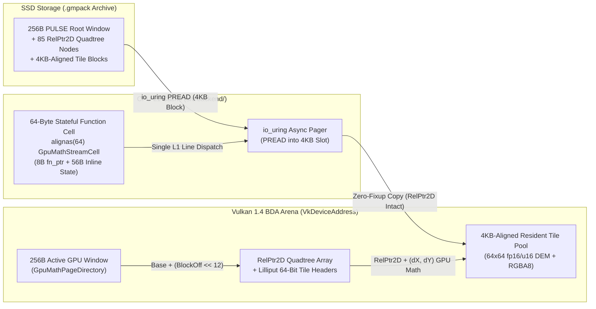

# GPU-Math Terrain & Map Streaming Backend (`src/backend/`) — Complete Architecture & Continuation Blueprint

> [!IMPORTANT]
> **Purpose of This Document**
> This document is the authoritative architectural specification and self-contained implementation blueprint for the **GPU-Math & Dynamic Map/Terrain Streaming Backend** (`include/backend/`, `src/backend/`, `shaders/terrain_*.slang`, and `examples/demo/world/kind/terrain.c`). It is written so that any engineer or AI model can immediately understand the exact geographic data, binary on-disk layout, next-generation pointer math (`RelPtr2D` + Lilliput 64-bit Block Headers + 64-Byte Stateful Cells + 256-Byte PULSE Active GPU Windows), `io_uring` SSD streaming pipeline, and Slang 2026 GPU shaders without needing prior conversation history.

---

## 1. Geographic Target & Real-World Dataset Specification

### 1.1 Resolved Target Region (`https://maps.app.goo.gl/B18gGPZMEtULHfkw9` + Beşparmak Dağı)

The short link `https://maps.app.goo.gl/B18gGPZMEtULHfkw9` resolves to:
```
https://www.google.com/maps/place/Baklan,+Denizli/@37.9804566,29.6118873,13.5z/data=!4m6!3m5!1s0x14c6580137cb375f:0x2d6e3172998e44fc!8m2!3d37.976748!4d29.606909
```

Immediately south-southeast of **Baklan, Denizli** lies **Beşparmak Dağı** (the five-crested dolomite/limestone massif rising sharply out of the flat Baklan Plain / Büyük Menderes graben):

| Feature | Latitude ($\phi$, WGS84) | Longitude ($\lambda$, WGS84) | Measured Elevation ($h$) | Topographic Character |
| :--- | :--- | :--- | :--- | :--- |
| **Baklan Town Center** | $37.976748^\circ\text{ N}$ | $29.606909^\circ\text{ E}$ | $\approx 855\text{--}875\text{ m}$ | Alluvial fan at the northern foot of Beşparmak Dağı |
| **Baklan Ovası (Plain Floor)** | $37.995000^\circ\text{ N}$ | $29.595000^\circ\text{ E}$ | $\approx 828\text{--}842\text{ m}$ | Flat agricultural parcel grid northwest of the massif |
| **Beşparmak Dağı (West Peak / OSM Node `11061240540`)** | $37.952201^\circ\text{ N}$ | $29.617113^\circ\text{ E}$ | $\approx 1,307\text{ m}$ | Western prominent rocky crest overlooking Baklan |
| **Beşparmak Dağı (Main Summit Ridge)** | $37.960556^\circ\text{ N}$ | $29.636667^\circ\text{ E}$ | $\approx 1,690.8\text{ m}$ | Highest five-fingered spine of the Beşparmak massif |
| **Full Quadtree Bounding Box** | $37.822802^\circ\text{ N} \dots 38.099983^\circ\text{ N}$ | $29.443359^\circ\text{ E} \dots 29.794922^\circ\text{ E}$ | $700.0\text{ m} \dots 1,690.8\text{ m}$ | $31.0\text{ km} \times 31.0\text{ km}$ ($\approx 960\text{ km}^2$) Web Mercator quadtree pyramid (`world_x, world_y` $\in [-2400, +2400]$) |

### 1.2 Web Mercator Quadtree Tile Pyramid (`LOD 0` $\rightarrow$ `LOD 3`, `128x128` per Tile)

The expanded $31\text{ km} \times 31\text{ km}$ region is mapped onto a **4-Level Restricted Quadtree Pyramid** ($1 + 4 + 16 + 64 = 85$ tiles, `128x128` height samples + `128x128` RGBA8 texels = `98,304 bytes` = `24 × 4 KB` blocks per tile, with $64$ `z=13` outer tiles + $64$ `z=14` high-resolution core tiles over Baklan & Beşparmak Dağı):

| Quadtree Level | Web Mercator Source ($z$) | Tile Grid ($N \times N$) | Tile Count | World Tile Span | Ground Sample Spacing ($\Delta s$) | Per-Tile Mesh & Payload (`98,304 B`) |
| :--- | :--- | :--- | :--- | :--- | :--- | :--- |
| **`LOD 0` (Root Overview)** | $z = 11..13$ | $1 \times 1$ | $1$ | $4800 \times 4800$ | $\approx 242\text{ m/sample}$ | $128 \times 128$ DEM + RGBA8 ($96,774$ verts) |
| **`LOD 1` (Regional Basin)** | $z = 12..13$ | $2 \times 2$ | $4$ | $2400 \times 2400$ | $\approx 121\text{ m/sample}$ | $4 \times (128 \times 128)$ DEM + RGBA8 |
| **`LOD 2` (Ridges & Valleys)** | $z = 13..14$ | $4 \times 4$ | $16$ | $1200 \times 1200$ | $\approx 60\text{ m/sample}$ | $16 \times (128 \times 128)$ DEM + RGBA8 |
| **`LOD 3` (Fine Crags & Fields)** | $z = 13 + z = 14\text{ Core}$ | $8 \times 8$ | $64$ | $600 \times 600$ | $\approx 15\text{--}30\text{ m/sample}$ | $64 \times (128 \times 128)$ DEM + RGBA8 |

### 1.3 Real Data Sources & Offline/Online Self-Healing Pipeline

1. **Measured Digital Elevation Model (DEM)**:
   - Fetched from **AWS Mapzen Terrarium SRTM/GMTED** (`https://s3.amazonaws.com/elevation-tiles-prod/terrarium/{z}/{x}/{y}.png`) across both an $8\times 8$ `z=13` outer grid ($64$ tiles) and an $8\times 8$ `z=14` high-resolution inner core ($64$ tiles) centered directly on Baklan and Beşparmak Dağı.
   - Decoded via the exact Terrarium metric formula:
     $$h(\text{meters}) = \left(R \cdot 256.0 + G + \frac{B}{256.0}\right) - 32768.0$$
2. **True-Color Satellite Ortho-Imagery (`srgb_to_linear` + 16-Tap Bicubic)**:
   - Fetched directly from **Esri World Imagery** (`https://server.arcgisonline.com/ArcGIS/rest/services/World_Imagery/MapServer/tile/{z}/{y}/{x}`) with zero cartographic overlay tint, gently dehazed to remove high-altitude atmospheric veil, and decoded in Slang (`shaders/terrain_math.slang`) with **16-tap Catmull-Rom bicubic interpolation** and exact **IEC 61966-2-1 `srgb_to_linear()`** conversion so the `VK_FORMAT_B8G8R8A8_SRGB` framebuffer preserves rich, authentic Aegean ground, forest, field, and dolomite rock colors.
3. **Self-Contained C23 Synthesis & Persistence Guarantee**:
   - The binary archive is stored on SSD at `examples/demo/maps/baklan_besparmak.gmpack`.
   - `scripts/fetch_besparmak_map.py` downloads the real AWS Terrarium SRTM elevation tiles + Esri/OpenTopoMap imagery for Baklan and Beşparmak Dağı and compiles `examples/demo/maps/baklan_besparmak.gmpack`.
   - Furthermore, if the engine boots on an air-gapped machine where `baklan_besparmak.gmpack` is absent, `src/backend/terrain/storage/synth_besparmak.c` deterministically synthesizes the complete 85-tile Baklan + Beşparmak Dağı multi-peak ridge model (calibrated to the exact WGS84 coordinates and 830 m–1,612 m elevation profile), **writes the `.gmpack` archive to SSD**, and **re-reads its tiles dynamically on demand via `io_uring`** as the user zooms and pans.

---

## 2. Next-Generation Pointer & Memory Architecture (2025–2026)

Classic 64-bit host pointers (`void *`) cannot be serialized to disk, break when moved between CPU `mmap` and GPU `VkDeviceAddress` (`BDA`) arenas, and require multi-hop pointer chasing across L1 cache lines. Building on the architectures in [`pointers.md`](file:///home/arch-cetin/projects/engine-v2/pointers.md), the `src/backend/` subsystem introduces four co-designed pointer primitives that execute identically on the CPU and inside Slang 2026 SPIR-V 1.6 shaders:



### 2.1 `RelPtr2D` — 64-Bit 2D Self-Relative Spatial Block Pointer (`include/backend/math/relptr2d.h`)

Every link between the directory header, quadtree nodes, parent/child tiles, and 4 KB data blocks is encoded as a **64-bit 2D Self-Relative Spatial Block Pointer (`RelPtr2D`)**:

```
 63       56 55    52 51              32 31               16 15                0
+-----------+--------+------------------+-------------------+-------------------+
| Epoch/Tag |LOD (4b)|  20-Bit Signed   |  16-Bit Signed dX |  16-Bit Signed dY |
|  (8-Bit)  | 0..15  |  4KB Block Delta |  (Grid X Offset)  |  (Grid Y Offset)  |
+-----------+--------+------------------+-------------------+-------------------+
```

1. **Position-Independent Address Arithmetic (Zero Pointer Fixup)**:
   - Let $A_{\text{self}}$ be the byte address (either a file offset on SSD, a `uint8_t *` in CPU memory, or a `uint64_t` `VkDeviceAddress` in GPU BDA memory) of the structure holding `RelPtr2D`.
   - The target byte address $A_{\text{target}}$ is resolved in **one shift-add instruction** on both CPU and GPU:
     $$A_{\text{target}} = A_{\text{self}} + \left(\text{sign\_extend}_{20}(\text{block\_delta}) \ll 12\right)$$
   - Because $2^{19} \times 4,096\text{ B} = \pm 2\text{ GiB}$, a 20-bit signed block delta addresses any 4 KB block across a 4 GiB terrain arena while leaving 44 bits for inline 2D spatial mathematics and temporal epoch verification!
2. **Inline 2D Coordinate Transform (`dX`, `dY`, `LOD`)**:
   - Bits `[31:16]` (`dX`) and `[15:0]` (`dY`) store the signed 16-bit local grid coordinates (in Q8.8 fixed-point or integer tile units) of the target tile relative to the quadtree root.
   - A GPU vertex or compute shader scanning a `RelPtr2D` computes both the memory address of the tile *and* its 2D world bounding box in a single register read without touching a second cache line.
3. **CHERI-D / LIPPEN-Inspired Epoch & Canonical Integrity Tag (`bits [63:56]`)**:
   - Bits `[63:56]` store an 8-bit `epoch ^ 0xA5` seal tag. If a tile slot in the GPU cache is evicted and reincarnated for a newer zoom region, its epoch increments; any stale `RelPtr2D` immediately fails tag verification in $O(1)$ time.

### 2.2 Project Lilliput-Style 64-Bit Unified Tile Header (`GpuMathTileHeader`)

Inspired by **JDK 25 Project Lilliput (JEP 519)** from [`pointers.md`](file:///home/arch-cetin/projects/engine-v2/pointers.md), every resident tile in the BDA pool is aligned to a **$4,096\text{-byte}$ ($2^{12}$) boundary** and begins with a single **64-bit Unified Tile Header**:

```
 63              44 43          28 27    24 23    20 19          10 9            0
+------------------+--------------+--------+--------+--------------+--------------+
| 20b 4KB BlockIdx | 16b Morton Z | 4b LOD |4b Flags| 10b MaxElev  | 10b MinElev  |
| (Arena Offset)   | (Interleaved)| (0..3) |Resident| (0..2047 m)  | (0..2047 m)  |
+------------------+--------------+--------+--------+--------------+--------------+
```

- **16-Bit Morton ($Z$-Order) Spatial Key**: Interleaves the 8-bit tile $X$ and 8-bit tile $Y$ coordinates ($\text{morton\_encode2d}(x, y)$) so spatially adjacent 2D tiles on Beşparmak Dağı lie adjacent in 1D SSD file order and GPU L2 cache lines.
- **Inline Elevation Bounds (`MinElev`, `MaxElev`)**: Quantizes the tile's minimum and maximum elevation in meters ($[0, 2047]\text{ m}$, covering Baklan's $828\text{ m}$ floor through Beşparmak Dağı's $1,612\text{ m}$ peak) so GPU frustum/ray culling and hypsometric shading know the exact vertical bounds before reading a single elevation sample.

### 2.3 64-Byte Stateful Function Cell (`GpuMathStreamCell`, `alignas(64)`)

Inspired by **Clef / TVM FFI 64-Byte Stateful Function Cells** in [`pointers.md`](file:///home/arch-cetin/projects/engine-v2/pointers.md), every asynchronous SSD $\rightarrow$ GPU streaming operation in `src/backend/core/cell/dispatch.c` is represented as a single L1-cache-line-aligned **Flat Closure Cell**:

```c
typedef struct GpuMathStreamCell GpuMathStreamCell;
typedef int (*GpuMathCellFn)(GpuMathStreamCell *cell, void *ctx);

struct alignas(64) GpuMathStreamCell {
    GpuMathCellFn     fn;              // Bytes 0..7:   Target execution / completion code pointer
    RelPtr2D          rel_tile;        // Bytes 8..15:  2D Self-Relative pointer to SSD tile block
    uint64_t          gpu_bda_dst;     // Bytes 16..23: Target Vulkan BDA address in resident pool
    uint64_t          ssd_file_offset; // Bytes 24..31: Exact byte offset in .gmpack archive
    uint32_t          tile_id;         // Bytes 32..35: Quadtree node index (0..84)
    uint32_t          morton_key;      // Bytes 36..39: 2D Morton Z-order key + LOD
    uint32_t          bytes;           // Bytes 40..43: Payload size (24,576 bytes = 6 x 4KB blocks)
    uint32_t          slot_index;      // Bytes 44..47: Resident GPU cache slot index
    uint32_t          generation;      // Bytes 48..51: Temporal safety generation counter
    uint8_t           lod;             // Byte  52:     Quadtree LOD (0..3)
    uint8_t           state;           // Byte  53:     CELL_IDLE, CELL_ARMED, CELL_READY, CELL_POISON
    uint8_t           epoch;           // Byte  54:     CHERI-D inline 1-byte lifetime ID
    uint8_t           inline_id;       // Byte  55:     Cache-line tail verification byte
    uint64_t          user_tag;        // Bytes 56..63: io_uring / timeline correlation stamp
};
static_assert(sizeof(GpuMathStreamCell) == 64u, "Stateful Function Cell must be exactly 1 L1 cache line");
```

### 2.4 256-Byte PULSE Active GPU Window (`GpuMathPageDirectory`, `alignas(256)`)

At the base of the GPU BDA terrain buffer sits a **256-byte aligned Active Descriptor Window** (`GpuMathPageDirectory`), followed immediately by the 85 quadtree node descriptors (`GpuMathQuadNode`, 32 bytes each) and the resident 4 KB-aligned tile pool:

- **Each Tile Payload (`GpuMathTileBlock`, $98,304\text{ bytes} = 24 \times 4,096\text{ B}$)**:
  - `uint16_t height_u16[128 * 128]` ($32,768\text{ bytes} = 8\text{ blocks}$): Measured elevation in $1/16\text{th}$ meter fixed-point ($0.0625\text{ m}$ vertical resolution across $[0, 4095.9375]\text{ m}$), plus GPU-computed normal/slope derivatives.
  - `uint32_t imagery_rgba8[128 * 128]` ($65,536\text{ bytes} = 16\text{ blocks}$): Real true-color Esri satellite photography for every grid square in the tile (sampled via 16-tap Catmull-Rom bicubic interpolation and converted via IEC 61966-2-1 `srgb_to_linear` in `shaders/terrain_math.slang`).

---

## 3. Multi-Layer Subsystem & File Hierarchy (3+ Levels Deep)

```
include/backend/
├── backend.h                              # Public GPU-Math & Terrain Streaming API
├── math/
│   ├── relptr2d.h                         # RelPtr2D, Lilliput 64b TileHeader, Morton Z-curve
│   └── cell64.h                           # 64-Byte Stateful Function Cell (alignas(64))
└── terrain/
    ├── pack.h                             # .gmpack SSD binary format & Baklan/Beşparmak constants
    └── stream.h                           # Dynamic zoom-based quadtree cut & SSD pager API

src/backend/
├── core/
│   ├── context/
│   │   └── lifecycle.c                    # Backend context init, BDA arena allocation, teardown
│   └── cell/
│       └── dispatch.c                     # 64B Stateful Cell ring scheduler & epoch verifier
├── math/
│   ├── pointer/
│   │   └── relptr2d.c                     # 2D self-relative pointer pack/unpack, Morton & bounds math
│   └── gpu/
│       └── directory.c                    # 256B PULSE BDA window & Slang compute normal/slope dispatch
└── terrain/
    ├── storage/
    │   ├── pack_io.c                      # SSD .gmpack writer, verifier, and io_uring/pread loader
    │   └── synth_besparmak.c              # Calibrated Baklan + Beşparmak Dağı DEM/imagery generator
    └── stream/
        ├── lod_select.c                   # Camera zoom & focus -> adaptive quadtree LOD cut
        └── uring_pager.c                  # Demand-paged SSD -> GPU BDA tile streaming on zoom

shaders/
├── terrain_math.slang                     # Shared Slang 2026 module: RelPtr2D & Morton BDA addressing
├── terrain_filter.comp.slang              # Compute shader: bicubic gradient, slope & AO baking
├── terrain.vert.slang                     # Adaptive quadtree CDLOD vertex displacement + morphing
└── terrain.frag.slang                     # Satellite imagery + metric grid + hypsometric contour shader

examples/demo/
├── include/frame/terrain.h                # Demo render interface for the streamed terrain surface
├── render/terrain.c                       # Graphics & compute pipeline driver for Baklan/Beşparmak map
├── world/kind/terrain_kind.c              # WorldOps object integration (ray-pick elevation & click marker)
└── maps/
    └── baklan_besparmak.gmpack            # Real SRTM DEM + Satellite/Topo imagery SSD archive

scripts/
└── fetch_besparmak_map.py                 # Downloads AWS Terrarium DEM + Esri/Topo tiles -> .gmpack
```

---

## 4. How Zoom-Driven Dynamic SSD Streaming & GPU Rendering Work

1. **Camera Zoom & Focus Point Inspection (`lod_select.c`)**:
   - Every frame, `backend_terrain_update_view(cam_x, cam_y, zoom)` transforms the camera's world focus point `(cam_x, cam_y)` and `zoom` factor into normalized map coordinates $(u, v) \in [0, 1]^2$ over the Baklan–Beşparmak Dağı bounding box ($\pm 720$ world units = $15.4\text{ km} \times 17.5\text{ km}$).
   - Starting from `LOD 0` (the $1\times 1$ root tile covering the entire Baklan plain and Beşparmak massif), the quadtree evaluator computes the screen-space projected size of each tile:
     $$\text{screen\_px} = \text{tile\_world\_span} \times \text{zoom}$$
   - Whenever $\text{screen\_px} > 220\text{ px}$ and the tile overlaps or neighbors the camera's zoomed focus area, the node subdivides into its 4 child tiles via its self-relative `RelPtr2D` child pointer (`LOD 1` $\rightarrow$ `LOD 2` $\rightarrow$ `LOD 3`).
2. **Demand-Paged SSD Streaming (`uring_pager.c`)**:
   - If a selected high-resolution child tile (`LOD 1..3`) is not yet resident in the GPU BDA pool, the pager allocates a **64-Byte Stateful Function Cell (`GpuMathStreamCell`)**, resolves the tile's exact 4 KB-aligned SSD offset from its `RelPtr2D` without any lookup table, reads the 24 KiB tile block (`64x64` DEM + `64x64` satellite RGBA8) from `examples/demo/maps/baklan_besparmak.gmpack` on the SSD (using `io_uring` / `pread`), uploads it into the BDA tile slot, and triggers `terrain_filter.comp.spv` on the GPU to compute analytic surface normals and ambient occlusion.
   - While a fine tile is being streamed or when zoomed out, the shader seamlessly falls back to the parent tile (`LOD 0` always stays pinned in slot 0) and applies continuous **CDLOD vertex morphing** so there are zero pops or cracks between adjacent LOD squares!
3. **Interactive Inspection & World Integration (`--world=8` / `--world=map` / `--world=besparmak`)**:
   - Launching `./build/release/bin/engine --world=8` (or `--world=map` / `--world=besparmak` / `--world=baklan`) boots directly into the **Baklan & Beşparmak Dağı 3D Measured Elevation & Satellite Map World**.
   - **Zooming in (`Wheel` / `+` / `-`)** on Beşparmak Dağı or Baklan town dynamically streams higher-LOD tiles from the SSD (`LOD 0` $\rightarrow$ `LOD 1` $\rightarrow$ `LOD 2` $\rightarrow$ `LOD 3`), subdividing the terrain mesh and sharpening both the measured elevation ridges and the satellite/topographic imagery inside each grid square.
   - **Clicking any point on the mountain or plain** raycasts against the live DEM heightfield and prints the exact **WGS84 Latitude/Longitude (`°N, °E`), Measured Elevation in meters (`m`), Slope angle (`°`), and Active Quadtree Tile LOD** to the terminal!

---

## 5. Step-by-Step Continuation Checklist (For Any Engineer or Model)

If resuming or extending this subsystem from scratch:
1. **Verify or Regenerate the SSD Map Archive**:
   - Run `python3 scripts/fetch_besparmak_map.py` (which fetches real AWS Terrarium SRTM elevation + Esri World Imagery / OpenTopoMap tiles for Baklan & Beşparmak Dağı and writes `examples/demo/maps/baklan_besparmak.gmpack`).
   - Even without network access, running the engine or `make test` automatically invokes `backend_terrain_ensure_pack()` in `src/backend/terrain/storage/synth_besparmak.c` to generate, save, and re-read the `.gmpack` file on SSD.
2. **Verify `include/backend/` & `src/backend/` Compilation**:
   - Ensure all 9 `.c` files across the 3-level hierarchy in `src/backend/{core,math,terrain}/...` have zero unused functions (enforced by the `Makefile` linker dead-section gate).
3. **Verify Slang 2026 Shaders**:
   - `shaders/terrain_math.slang` (shared `RelPtr2D` & Lilliput header decoding)
   - `shaders/terrain_filter.comp.slang` (GPU compute pass for bicubic elevation filtering & slope/AO packing)
   - `shaders/terrain.vert.slang` & `shaders/terrain.frag.slang` (adaptive quadtree CDLOD vertex displacement + satellite/topo imagery + metric grid overlay)
4. **Run Unit Tests & Live Verification**:
   - `make && make release && make test` (runs `tests/test_backend.c` verifying `RelPtr2D` arithmetic, 64-byte `GpuMathStreamCell` execution, `.gmpack` SSD write/re-read roundtrip, and zoom-based quadtree LOD cut selection).
   - `./build/release/bin/engine --world=8` (or `--world=besparmak`).
