# Architectural Comparison: `engine-v2` vs. Mainstream Engines & Graphics Stacks

This document compares `engine-v2` (`v0.1.0`) against conventional game engines (Unreal Engine 5, Unity, Godot 4), standard C/C++ graphics stacks (`SDL3` / `GLFW` + `libwayland` + `VkSwapchainKHR`), and GIS/photogrammetry pipelines (`GDAL` + `Cesium` + offline MVS tools).

Rather than marketing claims, every section below compares **what actually happens on the CPU, in the Linux kernel, in L1/L2 cache lines, and on the GPU command processor**. At the end, we also state the exact trade-offs `engine-v2` makes and what `v0.1.0` does *not* yet include.

---

## Table of Contents

1. [At-a-Glance Comparison Matrix](#1-at-a-glance-comparison-matrix)
2. [Layer 1: OS Event Loop, Syscalls & Idle Power](#2-layer-1-os-event-loop-syscalls--idle-power)
3. [Layer 2: Windowing, Swapchain & Explicit Synchronization](#3-layer-2-windowing-swapchain--explicit-synchronization)
4. [Layer 3: GPU Memory & Shader Resource Binding](#4-layer-3-gpu-memory--shader-resource-binding)
5. [Layer 4: Pointer Architecture & Cache-Line Discipline](#5-layer-4-pointer-architecture--cache-line-discipline)
6. [Layer 5: Terrain Streaming & Photogrammetric Survey Fusion](#6-layer-5-terrain-streaming--photogrammetric-survey-fusion)
7. [Honest Trade-Offs & Where `v0.1.0` Sits Today](#7-honest-trade-offs--where-v010-sits-today)

---

## 1. At-a-Glance Comparison Matrix

| Subsystem / Metric | Commercial Engines (UE5 / Unity / Godot) | Standard Native Stack (`SDL3`/`GLFW` + Vulkan WSI) | **`engine-v2` (`v0.1.0`)** |
| :--- | :--- | :--- | :--- |
| **Release Binary Size** | `80 MiB` – `500+ MiB` (+ external `.pak`/shader dirs) | `5 MiB` – `30 MiB` + dynamic `.so` wrappers + `.spv` files | **`2.2 MiB` single ELF** (shaders & font `#embed`ded via ISO C23) |
| **Windowing & IPC** | SDL / custom wrapper $\to$ `libwayland-client` + X11 fallback | `SDL3` / `GLFW` $\to$ `libwayland-client` (`pthread` locks + proxy heap) | **Zero `libwayland`**. Hand-rolled binary wire codec directly on `io_uring` socket |
| **Kernel I/O & Polling** | Multi-thread job system + `epoll`/`poll` + `futex` wakes | `poll()`/`epoll_wait()` per frame + blocking `read()` on files | **Single-issuer `io_uring`** (`NO_MMAP`, `DEFER_TASKRUN`, `REGISTERED_FD_ONLY`, `NO_IOWAIT`, `1 ns` timer slack) |
| **Idle Scene Behavior** | Continuous `60–240 Hz` tick & present loop (measurable CPU/GPU watts) | Usually continuous `while (!quit)` loop or coarse `WaitEvents` | **True `0.0%` CPU & `0.0%` GPU**. Disarms `timerfd`, logs `Loop idle`, sleeps in kernel until input/inotify arrives |
| **Presentation & Sync** | `VkSwapchainKHR` (`vkAcquireNextImageKHR` + `vkWaitForFences`) | `VkSwapchainKHR` (driver-hidden buffer queue & implicit sync) | **WSI-free**. Exported `DMA-BUF` + `wp_linux_drm_syncobj_v1` timeline syncobjs; **never calls `vkWaitForFences`** on present |
| **Window Titlebar** | OS / XWayland / `libdecor` (`wl_shm` CPU software buffer) | `libdecor` / compositor SSD / `wl_shm` | **Dedicated Vulkan `DMA-BUF` on desynced `wl_subsurface`** with independent DRM release timeline |
| **GPU Resource Binding** | Descriptor pools, `VkDescriptorSet` tables, or bindless index heaps | `VkDescriptorSetLayout` + `vkUpdateDescriptorSets` | **Zero `VkDescriptorSet`s**. Pure Vulkan 1.4 64-bit `VK_KHR_buffer_device_address` pointers in push constants |
| **Spatial Data Pointers** | 64-bit host `void*` + JSON/custom deserialization & pointer fixup | `void*` / array indices; separate CPU and GPU struct layouts | **`RelPtr2D` (64-bit 2D self-relative block pointers)** + Lilliput 64b headers; identical bytes on SSD, CPU, and GPU |
| **Simulation Timing** | Coupled to frame `deltaTime` or multi-thread fixed accumulator | Often tied to `vsync` / frame time (`dt` jitter affects physics) | **Strict `8 ms` (`125 Hz`) `timerfd` quanta**, completely decoupled from `wl_surface.frame` display refresh |
| **Dead-Code Tolerance** | Millions of lines of unused runtime branches linked in | Unused helper functions stay unless LTO strips silently | **Hard build failure**: linker `--print-gc-sections` aborts build if *any* function in `src/` is unreferenced |

---

## 2. Layer 1: OS Event Loop, Syscalls & Idle Power

### How Conventional Stacks Do It
A typical Linux Vulkan app using `SDL3` or `GLFW` plus `libwayland-client` runs an event loop structured like this on every single frame:
1. `SDL_PollEvent()` calls `wl_display_prepare_read()`, acquires internal `libwayland` `pthread_mutex_t` locks, calls `poll()` on the Wayland FD, calls `recvmsg()` into `libwayland`'s ring buffer, allocates `wl_closure` structs on the heap to demux arguments, and invokes generated C callback proxies.
2. Timers, file hot-reloads, and asset streaming run either via separate `epoll` descriptors or on background worker threads synchronized via mutexes, condition variables (`futex` syscalls), and lock-free queues.
3. Even when nothing in the viewport is moving, most game loops continue waking `60`–`240` times per second, running empty scene traversal and re-submitting identical swapchain frames.

### How `engine-v2` Does It
All I/O—Wayland socket traffic, `8 ms` physics `timerfd` ticks, compositor `DMA-BUF` release `eventfd`s, `inotify` live file reloads, `signalfd`, and asynchronous SSD tile reads—shares **one single-issuer `io_uring` instance** on one thread ([`src/ring/`](../src/ring/), [`src/frame/loop/run.c`](../src/frame/loop/run.c)):
- **Zero `fdget`/`fdput` syscall tax**: Every persistent FD (`0..5`) and even the ring FD itself (`IORING_FEAT_REG_REG_RING`) is registered in kernel slots (`IORING_SETUP_REGISTERED_FD_ONLY`).
- **Zero per-packet re-arm syscalls**: Multishot reads (`IORING_OP_READ_MULTISHOT`) pop buffers automatically from application-allocated, hugepage-backed provided-buffer rings (`PBUF` for Wayland wire bursts, `SIM` for timer ticks).
- **Deferred taskwork (`IORING_SETUP_DEFER_TASKRUN`)**: Hardware/socket interrupts never preempt user-space simulation math to run kernel completion work; completions batch cleanly until `io_uring_enter2`.
- **`1 ns` wakeup precision + `0.0%` idle draw**: `prctl(PR_SET_TIMERSLACK, 1UL)` eliminates Linux's default `50 µs` timer fuzz while active. Once physics settle and keys are released, the `timerfd` disarms completely—zero syscalls/sec, zero GPU submits/sec, instant sub-millisecond wakeup on the next mouse move or keypress.

---

## 3. Layer 2: Windowing, Swapchain & Explicit Synchronization

```mermaid
flowchart TB
    subgraph Traditional["Standard Vulkan WSI (VkSwapchainKHR)"]
        T1["App calls vkAcquireNextImageKHR"] --> T2["Opaque WSI layer negotiates with libwayland"]
        T2 --> T3["vkQueueSubmit + vkQueuePresentKHR"]
        T3 --> T4["CPU blocks in vkWaitForFences for frame N-1"]
    end

    subgraph EngineV2["engine-v2 Explicit-Sync DMA-BUF Pipeline"]
        E1["GPU renders into exported PRIME DMA-BUF"] --> E2["vkQueueSubmit2 signals Timeline + SYNC_FD"]
        E2 --> E3["DRM_IOCTL_SYNCOBJ_FD_TO_HANDLE -> Acquire Timeline"]
        E3 --> E4["Raw Wayland wire: set_acquire + set_release + commit"]
        E4 --> E5["CPU sleeps in io_uring on release_eventfd (Zero Fence Wait)"]
    end
```

### Why Bypassing `VkSwapchainKHR` Matters
`VK_KHR_swapchain` was designed in 2015 to hide differences between Windows DXGI, X11, Android SurfaceFlinger, and early Wayland. On modern Wayland + Linux DRM, that abstraction costs real control:
- You cannot directly inspect or control which `DMA-BUF` format modifier tranche was chosen when resizing or switching GPUs.
- Window resizing (`VK_ERROR_OUT_OF_DATE_KHR`) routinely forces `vkDeviceWaitIdle()` or awkward swapchain recreation stalls while the user drags the window border.
- Client-side window titlebars via `libdecor` / `wl_shm` copy pixels from CPU RAM and synchronize clumsily during live resize drags.

In `engine-v2` ([`src/wayland/`](../src/wayland/), [`src/frame/present/`](../src/frame/present/)):
- **Direct DRM Timeline Sync (`wp_linux_drm_syncobj_v1`)**: The GPU signals the acquire timeline point directly inside the kernel DRM subsystem; the Wayland compositor signals the release timeline point when scanout/composition finishes. The CPU **never calls `vkWaitForFences`** on the present path.
- **Zero-Stall Window Resize (`orphans[0..7]`)**: During live window edge drags, buffers still held by the compositor are parked into an 8-slot generation-stamped orphan table (`SlotRef`) and reaped asynchronously when their release timeline fires—no `vkDeviceWaitIdle()`, no dropped frames.
- **Independent GPU Subsurface Titlebar**: The window bar renders on the GPU into its own `DMA-BUF` on a desynced `wl_subsurface` (`bar_slot[0..1]`), staying crisp at `32 px` height without waiting on 3D MSAA passes.
- **Explicit Muxless Hybrid GPU Support**: On dual-GPU laptops (`ENGINE_GPU=NVIDIA` presenting through an AMD/Intel display compositor), `engine-v2` renders in fast device-local VRAM and explicitly blits (`prime_copy`) into a cross-device linear `DMA-BUF` rather than silently degrading render targets to slow PCIe system RAM.

---

## 4. Layer 3: GPU Memory & Shader Resource Binding

### Evolution of GPU Binding Models
1. **Classic Binding (OpenGL / Vulkan 1.0 `VkDescriptorSet`)**: Every material, mesh, or uniform buffer requires creating layouts, sizing pools, allocating sets, and calling `vkUpdateDescriptorSets` + `vkCmdBindDescriptorSets` across draw calls. High CPU driver overhead; rigid pipeline layouts.
2. **Bindless Descriptor Arrays (UE5 / Modern DX12 / `VK_EXT_descriptor_indexing`)**: Stores everything in giant global descriptor arrays (`ResourceDescriptorHeap[index]`). Much better than per-draw binding, *but* still maintains a parallel shadow table of descriptors, slot allocators, and indirect array lookups before reaching actual buffer memory.
3. **Pure Descriptorless 64-Bit BDA (`engine-v2` on Vulkan 1.4)**:
   - **Zero descriptor sets, zero descriptor pools, zero descriptor heaps.**
   - Every GPU buffer has a real 64-bit virtual address (`VkDeviceAddress`), identical in spirit to a C pointer.
   - The CPU pushes a tiny struct of 64-bit addresses (`vkCmdPushConstants2`, `16–64 bytes`), and Slang 2026 shaders dereference typed pointers (`MaterialTable*`, `GpuMathPageDirectory*`, `SoftVertexState*`) straight through the GPU's L1/L2 cache hierarchy.
   - Combined with `VK_KHR_maintenance5` (no `VkShaderModule` wrapper objects) and C23 `#embed` (no external `.spv` file I/O at boot), pipeline bring-up is flat, fast, and immune to missing-asset path bugs.

---

## 5. Layer 4: Pointer Architecture & Cache-Line Discipline

Most C/C++ engines treat pointers the same way C did in 1989: 64-bit absolute virtual addresses (`void*`), `malloc`/`new` heap nodes scattered across pages, and serialization layers (JSON, FlatBuffers, custom binary readers) that parse disk files into freshly allocated CPU structs and then upload reorganized copies to the GPU.

`engine-v2` applies post-2024 pointer and cache-line research (documented in [`pointers.md`](../pointers.md)) directly in production C23 and Slang code:

| Mechanism in `engine-v2` | Where It Lives | Advantage Over Classic Engine Memory |
| :--- | :--- | :--- |
| **`RelPtr2D` (64-Bit 2D Self-Relative Spatial Block Pointer)** | [`include/backend/math/relptr2d.h`](../include/backend/math/relptr2d.h), [`shaders/terrain_math.slang`](../shaders/terrain_math.slang) | Encodes a signed 20-bit `4 KB` block offset ($\pm 2\text{ GiB}$), inline 16-bit `(dX, dY)` grid coordinates, 4-bit `LOD`, and an 8-bit `epoch ^ 0xA5` tag in one `uint64_t`. Resolves via `self + (delta << 12)` identically on SSD, in CPU RAM, and in GPU VRAM—**zero pointer swizzling or deserialization**. |
| **Lilliput-Style 64-Bit Unified Tile Header** | [`include/backend/math/relptr2d.h`](../include/backend/math/relptr2d.h) | Packs `20b` block index + `16b` Morton Z-curve key + `4b` LOD + `4b` flags + quantized `10b` min/max elevation (`0..2047 m`) into **8 bytes**. GPU frustum culling (`terrain_cull.comp.slang`) rejects out-of-view tiles before touching a single height sample. |
| **`alignas(64) GpuMathStreamCell` (64B Stateful Function Cell)** | [`include/backend/math/cell64.h`](../include/backend/math/cell64.h), [`src/backend/core/cell/dispatch.c`](../src/backend/core/cell/dispatch.c) | Co-locates the `8-byte` completion function pointer and `56 bytes` of `io_uring`/BDA state + CHERI-D `epoch`/`inline_id` lifetime tags inside **one exact L1 cache line**. Zero heap closure indirection, zero false sharing, $O(1)$ stale-cell rejection. |
| **Cache-Line Split `FrameState` & `FrameClock`** | [`include/frame/clock.h`](../include/frame/clock.h), [`include/frame/internal.h`](../include/frame/internal.h) | Compile-time `static_assert`s enforce that hot wake flags occupy bytes `0..63`, `FrameClock` occupies bytes `64..127`, and `FrameSlot` release gates sit separate from `VkImage` descriptors—eliminating accidental cache-line pollution on wakeups. |

---

## 6. Layer 5: Terrain Streaming & Photogrammetric Survey Fusion

In traditional GIS and simulation workflows, building an interactive georeferenced 3D terrain refined by drone/smartphone photography requires stitching together **three or four separate software ecosystems**:
1. **Photogrammetry / MVS Suite** (COLMAP, Agisoft Metashape, OpenDroneMap) — hours of offline batch processing to undistort lenses and triangulate dense elevation rasters.
2. **GIS Reprojection Tooling** (GDAL / PROJ) — converting GeoTIFFs, Warping WGS84/UTM, and slicing Web Mercator pyramids.
3. **3D Tile Compiler** (`3d-tiles` / Cesium ion / glTF converter) — packaging meshes + JSON manifests.
4. **Runtime Renderer** (Cesium Native / Unreal / WebGL) — parsing JSON/glTF on worker threads and uploading thousands of separate vertex buffers and textures.

In `engine-v2` (`World 8`, [`src/backend/terrain/`](../src/backend/terrain/)):
- **One Binary, Live In-Place Fusion**: `baklan_besparmak.gmpack` (`127.90 MiB`, 5 LOD levels `0..4`, `341` quadtree nodes, `256×256` `1/16 m` DEM + Esri satellite imagery across `24 km × 24 km` at `1:1` metric scale) streams directly from SSD into a GPU BDA arena via `io_uring`—and can even **self-synthesize from scratch in pure C23** (`synth_besparmak.c`) on an air-gapped machine if the file is missing.
- **Live Camera Calibration, MVS & Geodetic RBF**: Saving `besparmak_survey.manifest` wakes `inotify` on `io_uring`, runs Brown-Conrady lens undistortion (`k1..k3, p1, p2`), solves least-squares N-view 3D ray triangulation, sweeps candidate elevations with **Multi-View Stereo Patch-ZNCC** + parabolic sub-step refinement, warps RTK-GNSS control points and ridge breaklines with **$C^2$ Wendland radial basis functions**, performs occlusion-checked ortho-rectification, re-uploads affected BDA tile slots, and dispatches `terrain_filter.comp.slang` + `terrain_cull.comp.slang` (`vkCmdDrawIndirectCount`) **live while the camera stays interactive**.

---

## 7. Honest Trade-Offs & Where `v0.1.0` Sits Today

Good engineering means stating trade-offs plainly:

1. **Deliberate Platform Exclusivity**:
   - `engine-v2` runs **only** on modern **Linux (`7.1+`)**, native **Wayland** (with `zwp_linux_dmabuf_v1` and `wp_linux_drm_syncobj_v1`), **x86-64**, and **Vulkan 1.4** GPUs. It will not run on Windows, macOS, X11-only sessions, or older Vulkan 1.1/1.2 mobile drivers. That exclusivity is deliberate: refusing lowest-common-denominator portability is *why* the entire codebase stays ~53,000 lines with zero middleware glue.
2. **Manual Protocol & Memory Ownership**:
   - Because there is no `libwayland`, `liburing`, or garbage collector, protocol upgrades and BDA lifetime fences (`acquire_point` retirement, `SlotRef` generations) are maintained directly by engine code and verified by the 9 unit test suites (`make test`).
3. **`v0.1.0` Is the Foundation, Not Yet a Full Content Suite**:
   - Commercial engines like Unreal and Godot ship mature skeletal animation graphs, spatial audio, global illumination / ray-traced shadows, networked multiplayer replication, glTF/FBX PBR asset pipelines, and visual scene editors.
   - `engine-v2` `v0.1.0` does not have those higher-level content tools yet—because we built the hardest **foundation** first (the kernel I/O engine, explicit-sync Wayland swapchain, descriptorless BDA allocator, relocatable 2D pointer math, capability-masked workspace router, hybrid 3D/2D physics, SDF text, and streamed DEM + MVS terrain backend). Every system added in `v0.2+` inherits that zero-wrapper speed, `0%` idle footprint, and strict C23 clarity from day one.
