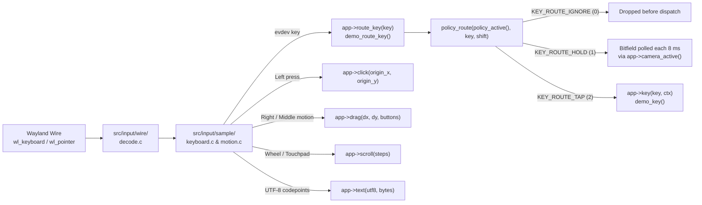

# Workflow, Controls, DSLs & Extensibility Guide

This guide explains how a hosted program (`examples/demo/`) plugs into the platform engine through [`include/engine/app.h`](../include/engine/app.h), how keyboard and mouse inputs flow through capability masks into C functions, how `F1`–`F10` switch worlds in place, how `.world` / `sheet.world` / `.manifest` / `window.chrome` files are parsed and hot-reloaded, and how to customize or mask any feature in C23.

---

## Table of Contents

1. [The `EngineApp` Seam & Callback Execution Order](#1-the-engineapp-seam--callback-execution-order)
2. [Keyboard & Mouse Dispatch Pipeline](#2-keyboard--mouse-dispatch-pipeline)
3. [Capability Masking, Profiles & Sealing (`policy.h`)](#3-capability-masking-profiles--sealing-policyh)
4. [Live World Switching (`F1`..`F10` / `0` & `world_switch_to`)](#4-live-world-switching-f1f10--0--world_switch_to)
5. [Declarative File Formats (`.world`, `sheet.world`, `.manifest`, `window.chrome`)](#5-declarative-file-formats-world-sheetworld-manifest-windowchrome)
6. [Programmatic C23 `WorldBuilder` API](#6-programmatic-c23-worldbuilder-api)
7. [Practical Customization Recipes](#7-practical-customization-recipes)

---

## 1. The `EngineApp` Seam & Callback Execution Order

Every binary links exactly one implementation of `const EngineApp *engine_app(void)`—implemented for the full 10-world showcase in [`examples/demo/demo.c`](../examples/demo/demo.c) (`build/<mode>/bin/engine`) and for the minimal pure-platform verification program in [`examples/minimal/minimal.c`](../examples/minimal/minimal.c) (`build/<mode>/bin/minimal`). All hooks run on the single `io_uring` thread and must remain non-blocking.

As documented in [`include/engine/app.h`](../include/engine/app.h), **7 `[REQUIRED]` hooks** (`init`, `shutdown`, `draw`, `advance`, `busy`, `click`, `key`) suffice to author a complete standalone interactive application; all remaining **24 `[OPTIONAL]` hooks** are null-safe with deterministic platform defaults (1-sample `VK_FORMAT_B8G8R8A8_SRGB` color-only pass, automatic 4-slice `bda_transient_begin_frame` / `bda_transient_abort_frame`, built-in tap/hold key routing, and platform `Loop idle` turn counters).

### Lifecycle & Per-Frame Hook Order
```text
1. Startup (before kernel/Vulkan init):
   app->configure(argc, argv)          Parse CLI flags (--world=..., --list-worlds)

2. Platform Boot Complete:
   app->init(vk, forward_cqe, user)    Compile Slang pipelines, allocate BDA arenas
   app->create_targets(vk, targets, w, h)  Create per-slot depth + MSAA coverage images
   app->load()                         Populate the opening world (default: World 0)

3. On Every 8 ms Simulation Tick (only while bodies/camera/heat are active):
   app->simulation(wall_ms, &step, &heat_dt)   Step 3D motion, 2D sheet, heat pulse
   app->advance(sim_cursor_ms, &step)          Advance continuous camera holds & spins

4. On Every Owed Frame (paced by wl_surface.frame):
   app->clear_color(rgba)              Query current world backdrop color
   app->record_compute(cmd, heat_dt, live)  Dispatch bevel, heat, soft-body & terrain cull compute
   app->claim_frame(acquire_sem, pt)   Claim ring-buffered BDA staging slice for `pt`
   app->prepare_draw(cmd, depth_img)   Emit pre-pass barriers
   app->draw(cmd, w, h, live)          Record 3D/2D scene inside single dynamic rendering pass
   app->draw_overlay(cmd, ...)         Record gimbal, math plots, SDF text, and 5-line GPU HUD
   app->record_ok(pt) / record_abort() Commit or roll back staging slice state

5. On Compositor Commit / Slot Retirement:
   app->commit()                       Fold presented state into shown snapshot
   app->release_frame(pt)              Reclaim staging slices whose timeline point retired

6. Shutdown (reverse LIFO):
   app->destroy_targets(...)
   app->shutdown(vk)
```

> [!NOTE]
> Returning `EngineTargets` with `depth_image = VK_NULL_HANDLE` and `samples = 0` tells the platform engine that the current slot needs no 3D depth/MSAA pass—used automatically by pure empty or 2D-only configurations to avoid unnecessary VRAM traffic.

---

## 2. Keyboard & Mouse Dispatch Pipeline

The platform engine (`src/input/`) decodes raw Wayland `wl_keyboard` and `wl_pointer` packets, tracks `xkbcommon` UTF-8 text composition and Shift state, converts surface coordinates into centered metric coordinates, and hands clean events across `EngineApp`:



### Coordinate Convention
Wayland reports pointer coordinates with `(0, 0)` at the top-left of the surface and `+Y` pointing down. Before calling `app->click(origin_x, origin_y)`, `src/frame/loop/input.c` normalizes coordinates around the center of the content area:
$$x_{\text{origin}} = x_{\text{surface}} - \frac{W}{2}, \qquad y_{\text{origin}} = \frac{H}{2} - y_{\text{surface}}$$
so `(0, 0)` is the center of the viewport, `+X` points right (East), and `+Y` points up (North).

### Hold vs. Tap Classification (`route_key`)
In [`examples/demo/include/frame/policy.h`](../examples/demo/include/frame/policy.h), `EngineAction` places all continuous camera actions in one contiguous enum block (`ACT_PAN_LEFT` through `ACT_PITCH_DOWN`, verified by `static_assert`).
- When a bound key maps to `ACT_PAN_LEFT .. ACT_PITCH_DOWN` and its permission bit is set, `policy_route()` returns `KEY_ROUTE_HOLD` (`ENGINE_KEY_HOLD`). Pressing that key keeps `app->camera_active()` returning `true`, which keeps the `8 ms` native multishot `IORING_OP_TIMEOUT` armed so `policy_held_axis()` smoothly integrates camera velocity every tick.
- Any permitted action after `ACT_PITCH_DOWN` returns `KEY_ROUTE_TAP` (`ENGINE_KEY_TAP`), invoking `demo_key()` once on key-down.
- Any unbound key—or any action whose permission bit is currently `0`—returns `KEY_ROUTE_IGNORE` (`0`) right at the input gate, so an ignored press never even wakes a sleeping scene.

### Shift-State Matching Precedence
Each `KeyBind` entry specifies `{ evdev_key, need_shift, action }`:
- `KEY_SHIFT_UP (0)`: Matches only when Shift is **not** held.
- `KEY_SHIFT_DOWN (1)`: Matches only when Shift **is** held.
- `KEY_SHIFT_ANY (2)`: Fallback match regardless of Shift state.

`policy_lookup()` always prefers an exact `KEY_SHIFT_UP` or `KEY_SHIFT_DOWN` entry over a `KEY_SHIFT_ANY` entry. That is how `4` alone spawns a Cylinder (`ACT_SPAWN_SOLID_4`, `KEY_SHIFT_UP`) while `Shift + 4` (`+` on Turkish/ISO layouts) zooms in (`ACT_ZOOM_IN`, `KEY_SHIFT_DOWN`).

---

## 3. Capability Masking, Profiles & Sealing (`policy.h`)

No keyboard or mouse action in `examples/demo/` runs unconditionally. Every feature is gated by a 16-bit permission mask inside `WorkspacePolicy` ([`examples/demo/world/policy.c`](../examples/demo/world/policy.c)):

| Permission Constant | Bit | What It Gates |
| :--- | :---: | :--- |
| `PERM_CAM_PAN_X` | `1 << 0` | Horizontal pan (Left/Right arrows, Middle-drag X) |
| `PERM_CAM_PAN_Y` | `1 << 1` | Vertical pan (Up/Down arrows, Middle-drag Y) |
| `PERM_CAM_ZOOM` | `1 << 2` | Mouse wheel, touchpad pinch/scroll, `+` / `-` |
| `PERM_CAM_YAW` | `1 << 3` | Orbit yaw (`Q` / `E`, Right-drag X) |
| `PERM_CAM_PITCH` | `1 << 4` | Orbit pitch (`C` / `V`, Right-drag Y) |
| `PERM_CAM_SNAP` | `1 << 5` | Numpad `1, 2, 4, 5, 6, 7, 8` & `Home` camera views |
| `PERM_OBJ_SELECT` | `1 << 6` | Left-click picking and impulse shoving on 3D/2D bodies |
| `PERM_OBJ_SPAWN` | `1 << 7` | Keys `1`–`6` raising non-cube 3D solids |
| `PERM_OBJ_DELETE` | `1 << 8` | `X`, `Delete`, `Backspace` removal and `Z` undo restore |
| `PERM_OBJ_SPIN` | `1 << 9` | `R` (toggle continuous spin) and `F5` (respin impulse) |
| `PERM_OBJ_MATERIAL` | `1 << 10` | `S` (smooth vs. faceted normals) and `G` (emissive glow) |
| `PERM_OBJ_COMPUTE` | `1 << 11` | 3D fillet bevel & 5-second click heat diffusion compute |
| `PERM_PLOT_CYCLE` | `1 << 12` | `M` cycling 3D math / CSV plot surfaces |
| `PERM_DATA_RELOAD` | `1 << 13` | `L` live hot-reloading `.world`, `sheet.world`, CSV, OBJ, `.manifest` |
| `PERM_MODE_SWITCH` | `1 << 14` | `Tab` cycling `MODE_3D -> MODE_2D -> MODE_HYBRID` |
| `PERM_DRAW` | `1 << 15` | Empty-ground clicks placing vertices and `F` ear-clipping faces |

### The Three Base Workspace Profiles
1. **`policy_blender()` (`MODE_3D`)**: Full 6-DOF quaternion orbit camera, 3D solid spawning, smooth/glow materials, heat compute, plots, reload, and `Tab` switching (`PERM_DRAW` starts off; `Numpad 9` toggles it).
2. **`policy_matplotlib()` (`MODE_2D`)**: Sets `lock_2d_quat = true` (locking the camera to identity quaternion on `z = 0`) and **revokes** `PERM_CAM_YAW`, `PERM_CAM_PITCH`, `PERM_OBJ_SPAWN`, `PERM_OBJ_MATERIAL`, and `PERM_OBJ_COMPUTE`. Runs only the flat 2D rigid/soft-body sheet solver.
3. **`policy_hybrid()` (`MODE_HYBRID`)**: Enables both the 3D scene and the 2D deformable sheet overlay simultaneously.

### Live Grants, Revocations & Sealing
At runtime, world presets or custom C code adjust capabilities via:
```c
WorkspacePolicy *p = policy_active();
policy_grant(p, PERM_DRAW);              // Enable click-to-draw polygon faces
policy_revoke(p, PERM_MODE_SWITCH);      // Lock user into current 3D or 2D mode
```
Setting `p->sealed = true` (or passing `seal = true` to `policy_apply_world()`) **freezes** the workspace: `policy_grant()`, `policy_revoke()`, `policy_rebind_key()`, `policy_switch()`, and `policy_set_mode()` all return `false` without modifying anything. World `0` (`Pure Empty Engine`) boots with `active_perms = PERM_NONE` and `sealed = true` so the blank engine does zero work until you explicitly switch into a world (`F1`–`F9`).

---

## 4. Live World Switching (`F1`..`F10` / `0` & `world_switch_to`)

Pressing `F1`–`F9` (Worlds `1..9`) or `F10` / `0` (`World 0`) inside [`demo_key()`](../examples/demo/demo.c) calls `world_switch_to(uint32_t world_id)` in [`examples/demo/world/world.c`](../examples/demo/world/world.c).

 Note that `F1`–`F10` are checked **before** `WorkspacePolicy` routing in `demo_key()`, so you can always leave a sealed world (like `World 0`) or a locked-mode world (like `World 1` or `World 8`) without restarting the process.

Inside `world_switch_to(id)`:
1. **Persist Live Edits**: If leaving the interactive sandbox, flushes current object placements to `examples/demo/world/live.world` and `sheet.live`.
2. **Reset Scene Tables (`world_reset()`)**: Clears generation-stamped 3D object slots, ear-clipped faces, non-cube solid state, 2D rigid/soft-body arrays, and camera velocities—while keeping the Vulkan 1.4 device, BDA pools, compiled pipelines, and Wayland `DMA-BUF` swapchain alive.
3. **Apply Target Policy (`policy_apply_world()`)**: Installs the new world's base mode (`MODE_3D`, `MODE_2D`, or `MODE_HYBRID`), grants/revokes specific `PERM_*` bits, toggles turntable vs. free quaternion orbit, and optionally seals the policy.
4. **Build Scene (`world_load()`)**: Populates the world from built-in `.world` / `sheet.world` assets, procedural C23 `WorldBuilder` calls (`World 7`), or the SSD-streamed `.gmpack` + `.manifest` terrain backend (`World 8`), and arms `inotify` on the new watched file path.

---

## 5. Declarative File Formats (`.world`, `sheet.world`, `.manifest`, `window.chrome`)

### 5.1 3D Scene Files (`examples/demo/world/*.world`)
Parsed by `parse_document()` in [`examples/demo/world/load.c`](../examples/demo/world/load.c). Blank lines and `#` comments are ignored:

```text
# Environment, UI & Policy Directives
mode hybrid                            # '3d', '2d', or 'hybrid'
ground z                               # Show infinite metric ground grid ('ground 0' / 'ground off' hides it)
draw 1                                 # Grant (1) or revoke (0) PERM_DRAW at load
tab 1                                  # Grant (1) or revoke (0) PERM_MODE_SWITCH at load
gimbal 1                               # Show/hide 3D orientation view-ball
hud 1                                  # Show/hide 5-line GPU hardware timing + BDA telemetry HUD
plot 0                                 # Show/hide 3D math/CSV plot surface
text 1                                 # Enable/disable HarfBuzz/FreeType SDF text boxes
contours 1                             # Enable/disable 20 m / 100 m topographic contours (World 8)
smooth 1                               # Default smooth (1) or flat-faceted (0) shading on solids
clear 0.02 0.04 0.08                   # Backdrop clear RGB in [0..1]
camera 0 -420 180 0 -0.314 1.0 0       # x y z yaw_rad pitch_rad zoom turntable(0|1)

# Single Primitives
cube 0 -180 600 yaw 38000 spin 1 inf 0 glow 1 bounce 0.85
solid Icosahedron -460 150 640 yaw 18000 spin 1 inf 1 glow 1 bounce 0.90
# Supported solid kinds: Tetrahedron, Octahedron, Icosahedron, Cylinder, Cone, Torus

# Composite Procedural Generators
ringcube  cx cy cz radius count [bounce [glow]]
gridcube  cx cy cz step_x step_y nx ny [bounce [glow]]
tower     base_x base_y base_z step_z count [bounce]
arcsolid  cx cy cz radius dz [bounce_min bounce_max]
solidring cx cy cz radius [bounce_min bounce_max]
helix     cx cy cz radius step_z count [bounce]

# Undo Tombstone (restored by pressing 'Z')
gone cube 100 0 0 yaw 0 spin 0 inf 0 glow 0 bounce 0.50
```

### 5.2 2D Physics Sheet Files (`examples/demo/world/sheet*.world`)
Parsed by [`examples/demo/world/sheet.c`](../examples/demo/world/sheet.c):

```text
gravity 0 -680                         # 2D acceleration vector (gx, gy)
bounds 580 310                         # Arena collision half-width and half-height

# Oriented Bounding Box: x y half_w half_h yaw_deg [bounce [fixed(0|1)]]
rigid -330 -120 110 18 -16 0.75 1

# Mass-Spring Soft Patch: origin_x origin_y cols rows spacing [spring [damp [bounce]]]
soft -340 150 5 4 32 22 1.0 0.78

# Regular Convex Polygon (SAT collision): cx cy radius vertex_count bounce
polyring -180 250 42 6 0.92
```

### 5.3 Photogrammetric & Geodetic Survey Manifest (`besparmak_survey.manifest`)
Parsed by [`src/backend/terrain/survey/manifest_io.c`](../src/backend/terrain/survey/manifest_io.c) when World 8 is active:

```text
# Dense Multi-View Stereo sweep window: <range_meters> <step_meters> <min_zncc>
mvs_config 18.0 0.40 0.55
persist_gmpack 0                       # 1 writes fused DEM/ortho tiles back to .gmpack on SSD

# Georeferenced smartphone / drone photo with Brown-Conrady lens calibration
photo "my_drone_shot.png" preset="DJI Mavic 3 Enterprise" focal_mm=12.29 \
      lat=37.9522 lon=29.6171 alt=1850 yaw=45 pitch=-60 roll=0 weight=0.95 mvs=1

# RTK-GNSS Ground Control Points, CSV clouds & ridge/fault breaklines (Wendland C2 RBF)
point_wgs84 37.960556 29.636667 1690.8 120.0 0.98
breakline_wgs84 37.9522 29.6171 1307.0 37.9605 29.6366 1690.8 45.0 0.95
gcp_list "rtk_benchmarks.txt" utm_zone=35 north=1 radius=25.0 weight=0.95

# Bird's-eye ortho-image overlay
ortho_overlay "images/overlay.png" wx=-139.61 wy=-4718.67 hx=256.75 hy=245.09 weight=1.00
```

### 5.4 Declarative Window Chrome (`chrome/window.chrome`)
Parsed at boot by [`src/chrome/spec.c`](../src/chrome/spec.c) to configure window title, Wayland `app_id`, cursor shape, edge-resize band width, and GPU-rendered titlebar layers/controls without recompiling C code.

### How Live `inotify` Hot-Reload Works
`EngineApp.watched_path()` returns the path of the active `.world` file (or `examples/demo/maps/besparmak_survey.manifest` in World 8). `src/frame/loop/watch.c` registers an `inotify` watch (`IN_MODIFY | IN_CLOSE_WRITE | IN_MOVED_TO`) on `ENG_INOTIFY_FD_SLOT` inside `io_uring`. Saving the file in any text editor posts an `ENG_UD_INOTIFY` CQE, invoking `EngineApp.reload_watched()` inside an `EngineRelay` bracket to rebuild the scene or re-fuse terrain tiles without resetting your live camera pose. Pressing `L` (`ACT_DATA_RELOAD`) triggers the same reload manually.

---

## 6. Programmatic C23 `WorldBuilder` API

When static text files are too rigid, [`examples/demo/world/builder.c`](../examples/demo/world/builder.c) lets you synthesize parametric worlds directly in C23 (as `World 7` does):

```c
#include "world/world_int.h"
#include "frame/policy.h"

int build_kinetic_arena(void) {
    WorldBuilder wb;
    world_builder_begin(&wb, true /* smooth_solids */);

    world_builder_set_mode(&wb, MODE_HYBRID);
    world_builder_set_draw(&wb, true);
    world_builder_set_tab(&wb, true);
    world_builder_set_ground(&wb, true);
    world_builder_set_gimbal(&wb, true);
    world_builder_set_hud(&wb, true);
    world_builder_set_clear(&wb, 0.03f, 0.05f, 0.10f);
    world_builder_set_camera(&wb, 0.0f, -520.0f, 260.0f, 0.0f, -0.34f, 0.90f, false);

    Coord origin = { 0.0f, 0.0f, 0.0f };
    world_builder_add_cube_ring(&wb, origin, 480.0f, 12u, 0.78f, true);
    world_builder_add_helix(&wb, origin, 260.0f, 70.0f, 8u, 0.88f);

    return world_builder_commit(&wb);
}
```

You can also generate `.world` syntax in memory and feed it straight to `world_load_string(doc, "generated")`.

---

## 7. Practical Customization Recipes

### Recipe 1: Bind a New Keyboard Shortcut (Tap or Continuous Hold)
Suppose you want `Shift + F` to freeze all 3D object velocities, gated by `PERM_OBJ_SPIN`:

1. **Add the semantic action** in [`examples/demo/include/frame/policy.h`](../examples/demo/include/frame/policy.h) (place it *after* `ACT_PITCH_DOWN` for a single-press tap, or *inside* the `ACT_PAN_LEFT .. ACT_PITCH_DOWN` range if you want continuous `8 ms` hold polling):
   ```c
   ACT_FREEZE_MOTION,
   ACT_COUNT
   ```
2. **Map its required permission bit** in `action_perm()` inside [`examples/demo/world/policy.c`](../examples/demo/world/policy.c):
   ```c
   case ACT_FREEZE_MOTION: return PERM_OBJ_SPIN;
   ```
3. **Bind the evdev key & Shift rule** (either in the compiled profile or dynamically at runtime):
   ```c
   policy_rebind_key(policy_active(), KEY_F, KEY_SHIFT_DOWN, ACT_FREEZE_MOTION);
   // Plain 'F' (KEY_SHIFT_UP) continues to trigger ACT_CLOSE_FACE undisturbed!
   ```
4. **Handle the action** inside `demo_key()` in [`examples/demo/demo.c`](../examples/demo/demo.c):
   ```c
   case ACT_FREEZE_MOTION:
       return world_freeze_motion(); // Return true if the screen needs a repaint
   ```

### Recipe 2: Mask Out Features or Lock a Kiosk / Viewer Mode
To create a read-only 3D inspection mode where the user can orbit and zoom the camera, but **cannot** spawn, delete, draw faces, reload files, or press `Tab`:
```c
uint32_t viewer_only_revoke =
    PERM_OBJ_SPAWN | PERM_OBJ_DELETE | PERM_OBJ_SPIN |
    PERM_OBJ_MATERIAL | PERM_DRAW | PERM_DATA_RELOAD | PERM_MODE_SWITCH;

policy_apply_world(MODE_3D,
                   PERM_NONE,          // extra grants
                   viewer_only_revoke, // stripped capabilities
                   true);              // seal = true: cannot be unlocked at runtime
```
Because `policy_route()` checks `active_perms` before classifying keys, pressing `1`–`6`, `X`, `S`, `G`, `L`, or `Tab` returns `KEY_ROUTE_IGNORE` immediately.

### Recipe 3: Give Mouse Clicks, Drags, or Scroll Wheels Custom Actions
All mouse hooks live in [`examples/demo/demo.c`](../examples/demo/demo.c):
- **Left Click (`demo_click(float origin_x, float origin_y)`)**: Already demonstrates three distinct context-dependent behaviors—picking/shoving 2D sheet bodies in `MODE_2D`/`MODE_HYBRID`, placing two-point geodesic survey markers `(Point A -> Point B)` on the DEM terrain in `World 8`, placing `Key_T` SDF text box corners, or ray-picking 3D objects / placing `PERM_DRAW` ground vertices. Insert your custom tool check at the top of `demo_click()` and return `true` to request a frame render.
- **Right / Middle Drag (`demo_drag(float dx, float dy, uint32_t buttons)`)**: Inspect `buttons & ENG_BUTTON_RIGHT` or `buttons & ENG_BUTTON_MIDDLE` alongside `policy_allows(...)` to route pointer drags into object gizmos, brush strokes, or custom camera controllers.
- **Wheel / Touchpad (`demo_scroll(float steps)`)**: Intercept `steps` to adjust brush radius, timeline scrubbers, or slice planes when a modifier key is held, falling back to `camera_zoom_by(steps)` otherwise.

### Recipe 4: Host a Brand-New C23 Application on the Engine Platform
Because `src/` has zero dependencies on `examples/demo/`, you can build a completely separate application (a CAD kernel, a scientific visualizer, a Wayland compositor tool, or a full game) by compiling `main.c` + `src/**/*.c` against your own single `.c` file implementing `const EngineApp *engine_app(void)`. Every `io_uring`, Wayland wire, `DMA-BUF`, DRM explicit-sync, and Vulkan 1.4 BDA facility works out of the box.
